# Benutzerhandbuch — Refwright

[English](en.md) · [한국어](ko.md) · [中文](zh.md) · [日本語](ja.md) · [Español](es.md) · **Deutsch** · [Français](fr.md) · [Português](pt.md)

Dieses Handbuch führt Sie durch das Plugin, von der Sammlung der Artikel bis zum Export eines
Word-Manuskripts. Alle Screenshots stammen aus dem echten Plugin. Die roten Zahlen in jedem
Screenshot entsprechen den nummerierten Schritten darunter.

**Arbeitsablauf:** Artikel sammeln → lesen und ordnen → suchen und fragen → zitieren → nach Word exportieren

**Inhalt**

0. [Einrichtung](#0-einrichtung)
1. [Die Oberfläche](#1-die-oberfläche)
2. [Artikel aus PubMed hinzufügen](#2-artikel-aus-pubmed-hinzufügen)
3. [Einen Artikel per DOI oder PMID hinzufügen](#3-einen-artikel-per-doi-oder-pmid-hinzufügen)
4. [Referenznotizen](#4-referenznotizen)
5. [Die Bibliothek durchsuchen](#5-die-bibliothek-durchsuchen)
6. [Im Manuskript zitieren](#6-im-manuskript-zitieren)
7. [Semantische Suche](#7-semantische-suche)
8. [Mit der Bibliothek chatten](#8-mit-der-bibliothek-chatten)
9. [Verwandte Artikel](#9-verwandte-artikel)
10. [Manuskript fertigstellen und nach Word exportieren](#10-manuskript-fertigstellen-und-nach-word-exportieren)
11. [Systematische Reviews (optional)](#11-systematische-reviews-optional)

---

## 0. Einrichtung

Installieren Sie das Plugin über **Settings → Community plugins → Browse**: Suchen Sie nach
„Refwright“, installieren und aktivieren Sie es. Geben Sie anschließend
einmalig Ihren KI-Schlüssel ein.

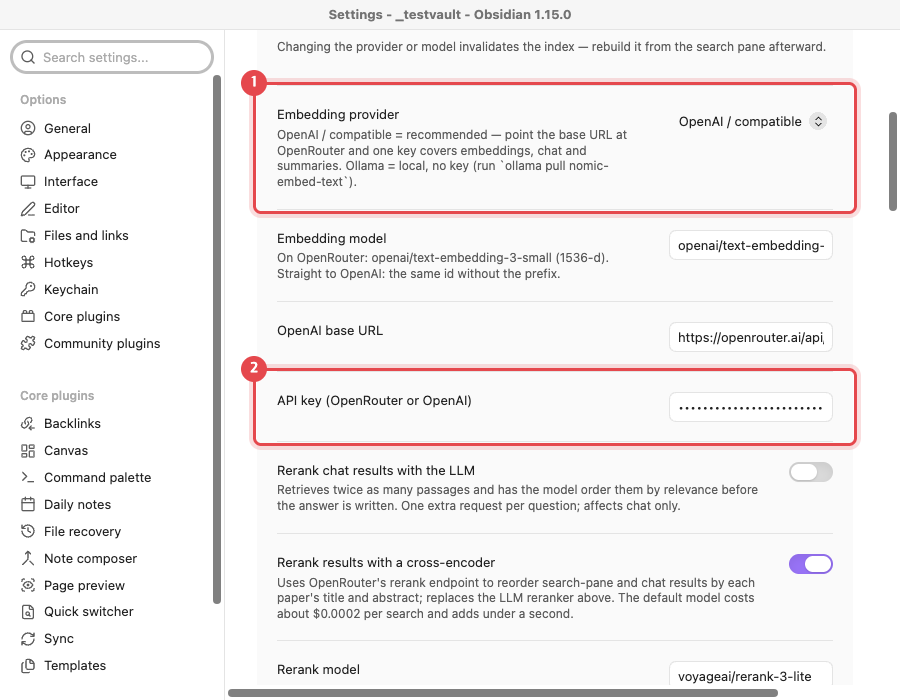

1. Lassen Sie **Embedding provider** auf `OpenAI / compatible`. Die Standard-Basis-URL ist
   OpenRouter, sodass ein einziger Schlüssel für Suche, Chat und Zusammenfassungen genügt.
2. Fügen Sie Ihren **OpenRouter**-Schlüssel ([openrouter.ai/keys](https://openrouter.ai/keys)) in **API key (OpenRouter or OpenAI)** ein. Der Schlüssel wird im
   Schlüsselbund Ihres Systems gespeichert, nicht in den Dateien des Vaults. Ein OpenAI-Schlüssel
   funktioniert auch, aber nur, wenn Sie **OpenAI base URL** auf `https://api.openai.com/v1`
   ändern — mit der Standard-URL muss es ein OpenRouter-Schlüssel sein.

> **Zum Zitieren ist kein Schlüssel nötig.** Artikel hinzufügen, `@`-Zitate und
> Literaturverzeichnisse funktionieren ohne KI-Schlüssel. Der Schlüssel wird nur für
> Zusammenfassungen, die semantische Suche und den Chat benötigt.

## 1. Die Oberfläche

Das Plugin fügt der linken Ribbon-Leiste drei Symbole und rechts ein Bibliotheksfenster hinzu.

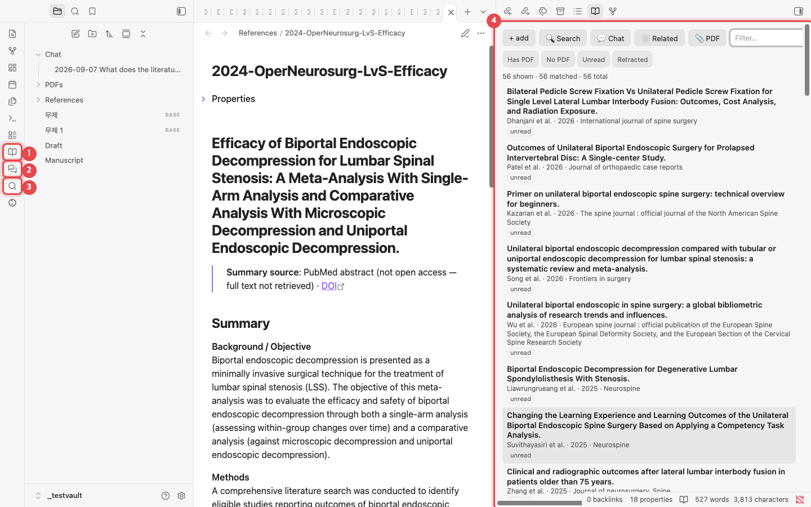

1. **Open library**: öffnet die Liste Ihrer Artikel.
2. **Chat with library**: öffnet einen Chat, der aus Ihren eigenen Artikeln antwortet.
3. **Search PubMed**: durchsucht PubMed und fügt Artikel hinzu.
4. **Library pane**: Jeder Artikel ist eine Notiz. Ein Klick auf einen Titel öffnet die Notiz.

## 2. Artikel aus PubMed hinzufügen

Der schnellste Weg, eine Bibliothek aufzubauen. Suchen Sie, haken Sie die gewünschten Artikel
an, und aus jedem wird eine Notiz mit Zusammenfassung und Themen-Tags.

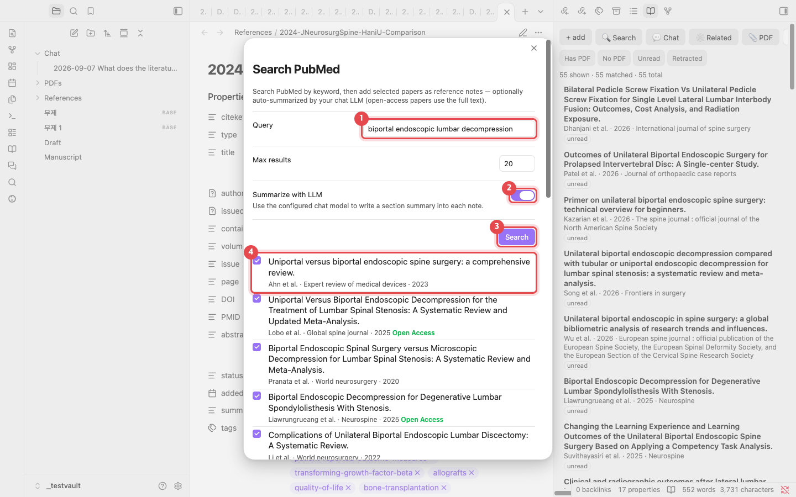

1. Geben Sie unter **Query** eine Suchanfrage ein, zum Beispiel
   `biportal endoscopic lumbar decompression`.
2. Lassen Sie **Summarize with LLM** eingeschaltet, um in jeder Notiz eine nach Abschnitten
   gegliederte Zusammenfassung zu erhalten. Bei Open-Access-Artikeln wird die Zusammenfassung
   aus dem Volltext erstellt.
3. Klicken Sie auf **Search**.
4. Haken Sie die Artikel an, die hinzugefügt werden sollen. Artikel mit der Markierung
   **Open Access** werden aus dem Volltext zusammengefasst.

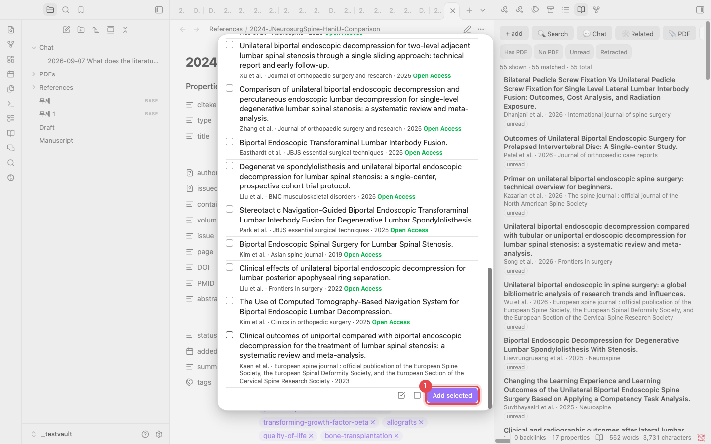

1. Klicken Sie unten in der Liste auf **Add selected**. Die beiden Symbole daneben wählen alle
   Einträge aus bzw. heben die Auswahl auf. Jeder Artikel braucht etwa 10–20 Sekunden; wenn er
   fertig ist, erscheint die Meldung „Added 1 reference.“

> **Keine Duplikate.** Ein Artikel, der bereits in Ihrer Bibliothek ist, wird anhand von DOI,
> PMID oder Titel erkannt und nicht erneut hinzugefügt.

## 3. Einen Artikel per DOI oder PMID hinzufügen

Wenn Sie den Artikel kennen, fügen Sie einfach seine Kennung ein. Klicken Sie im
Bibliotheksfenster auf **+ add** oder führen Sie in der Befehlspalette
„Add reference by DOI / PMID / arXiv“ aus.

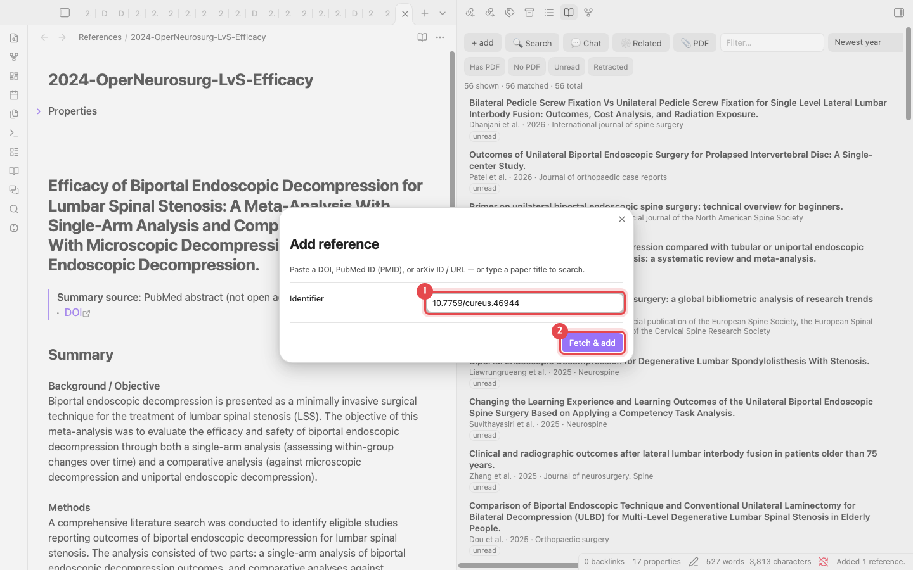

1. Geben Sie eine DOI (`10.7759/cureus.46944`), eine PMID (`38021704`) oder eine arXiv-ID ein.
   Auch ein Artikeltitel funktioniert; dann wird danach gesucht.
2. Klicken Sie auf **Fetch & add**. Die Metadaten stammen von Crossref und PubMed.

> **Sie haben ein PDF?** Mit **📎 PDF** im Bibliotheksfenster fügen Sie einen Artikel anhand
> seines PDFs hinzu. Die im PDF enthaltene DOI dient dazu, die Metadaten zu ergänzen.

## 4. Referenznotizen

Jeder Artikel wird als Markdown-Notiz in `References/` gespeichert. Die Dateien sind die
Datenbank, ein separates Programm wie Zotero ist also nicht nötig.

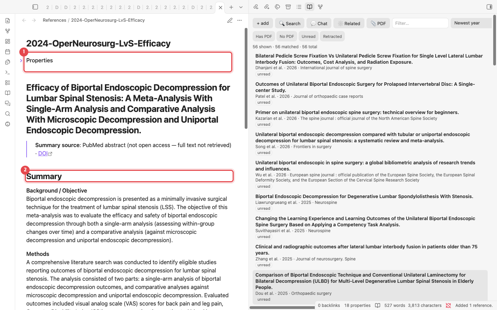

1. **Properties**: Autoren, Jahr, Zeitschrift, DOI, PMID und Tags (aus MeSH). Auch der
   Schlüssel zum Zitieren, der `citekey` (zum Beispiel `lv2024efficacy`), steht hier.
2. **Summary**: Background, Methods, Results und Conclusions. Eigene Notizen schreiben Sie
   weiter unten unter **Notes**.

## 5. Die Bibliothek durchsuchen

Filtern Sie das Bibliotheksfenster, wenn es wächst.

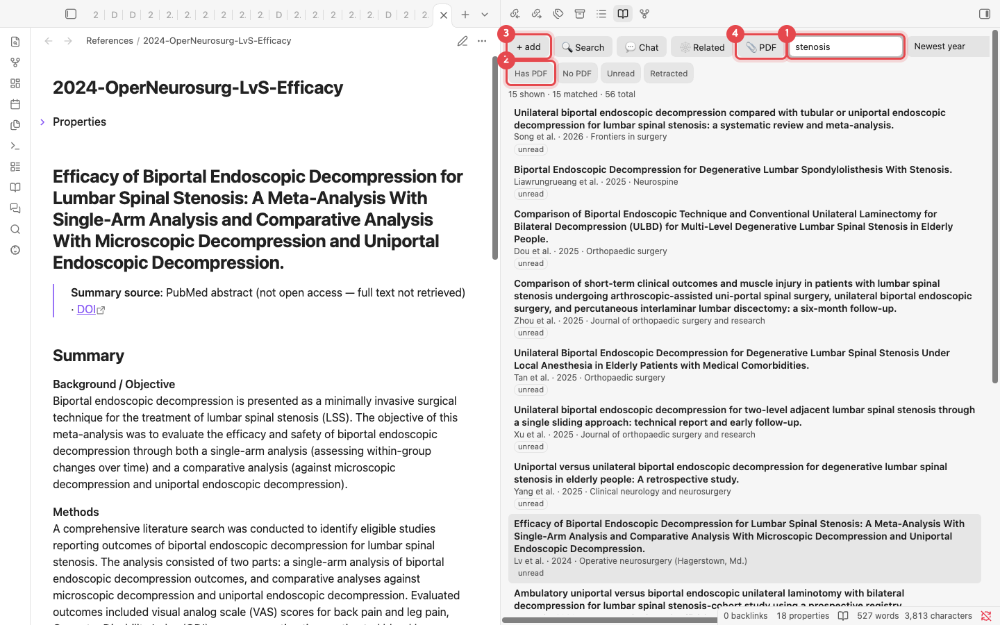

1. **Filter**: durchsucht Titel, Autoren und Tags. Die Eingabe `stenosis` lässt 15 von
   56 Artikeln übrig. Das Menü rechts daneben ändert die Sortierung (zum Beispiel neuestes
   Jahr zuerst).
2. **Quick filters**: zeigen nur Artikel mit PDF, ohne PDF, ungelesene oder zurückgezogene
   (retracted) Artikel.
3. **+ add**: öffnet den DOI/PMID-Dialog (Abschnitt 3).
4. **📎 PDF**: fügt einen Artikel aus einer PDF-Datei hinzu.

## 6. Im Manuskript zitieren

Schreiben Sie Ihr Manuskript in einer gewöhnlichen Notiz. Tippen Sie `@` an der Stelle, an
der ein Zitat stehen soll.

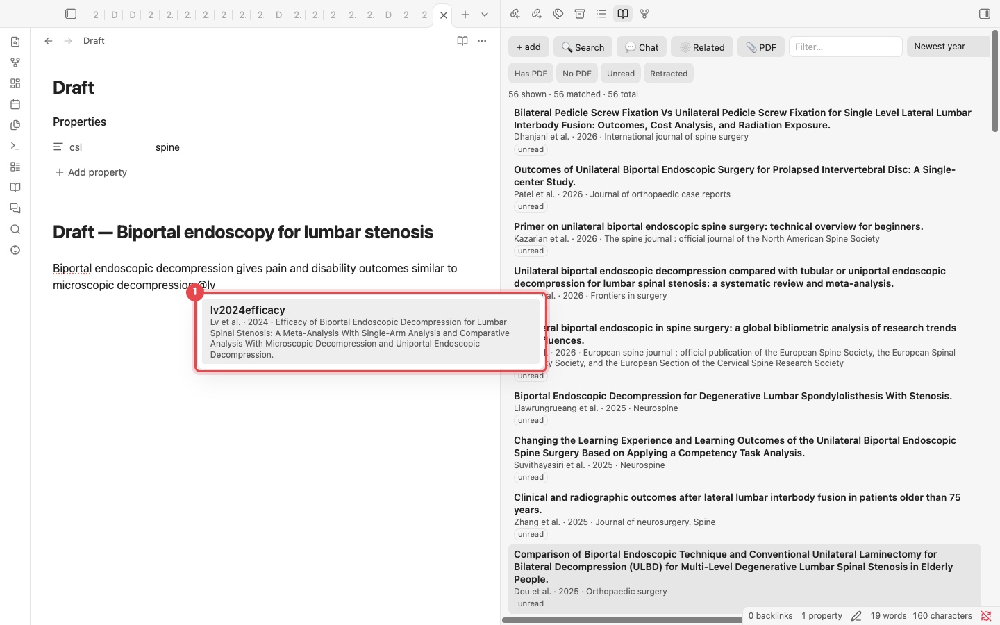

1. Tippen Sie nach dem `@` einen Teil eines Autorennamens oder Titels, um passende Artikel zu
   sehen. Mit <kbd>Enter</kbd> wird `[@lv2024efficacy]` eingefügt.

### Literaturverzeichnis erstellen

Tragen Sie den Zeitschriftenstil in die Properties der Notiz ein (`csl: spine`) und führen
Sie dann <kbd>Cmd/Ctrl</kbd>+<kbd>P</kbd> → **Update bibliography in current note** aus.

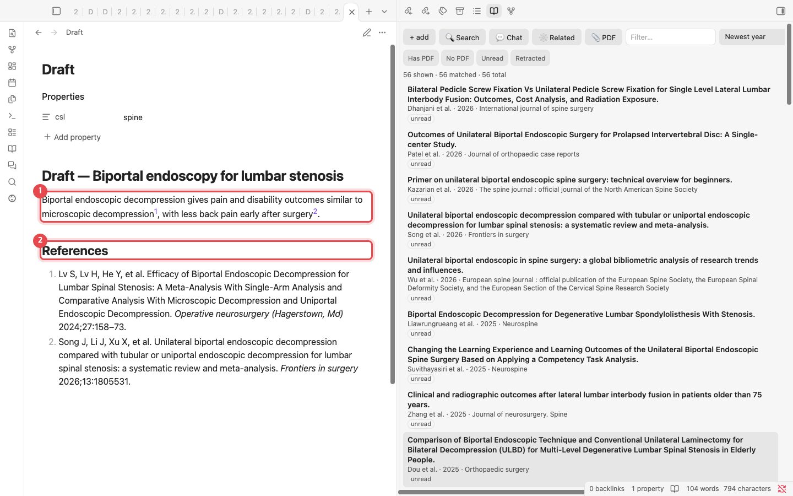

1. In der Leseansicht erscheint jedes `[@citekey]` im Stil der Zeitschrift (hier als hochgestellte
   Zahlen).
2. Am Ende der Notiz wird ein Abschnitt **References** im Format der Zeitschrift geschrieben.
   Führen Sie den Befehl nach dem Hinzufügen oder Entfernen von Zitaten erneut aus, um ihn
   zu aktualisieren.

> **Zeitschriftenstile**: `spine`, `apa`, `american-medical-association`, `elsevier-vancouver`
> und `springer-basic-brackets` sind integriert. Jede andere Stil-ID aus dem
> [CSL-Stilarchiv](https://github.com/citation-style-language/styles), etwa
> `vancouver` oder `nature`, wird bei der ersten Verwendung heruntergeladen. Sie kennen die ID nicht? Führen Sie **Choose citation
> style…** aus und tippen Sie den Namen der Zeitschrift.

## 7. Semantische Suche

Findet Passagen mit ähnlicher Bedeutung, auch wenn die Wörter abweichen. Öffnen Sie sie über
**Search** im Bibliotheksfenster. Klicken Sie zuvor einmal auf **Rebuild index** (bei etwa
50 Artikeln dauert das weniger als eine Minute).

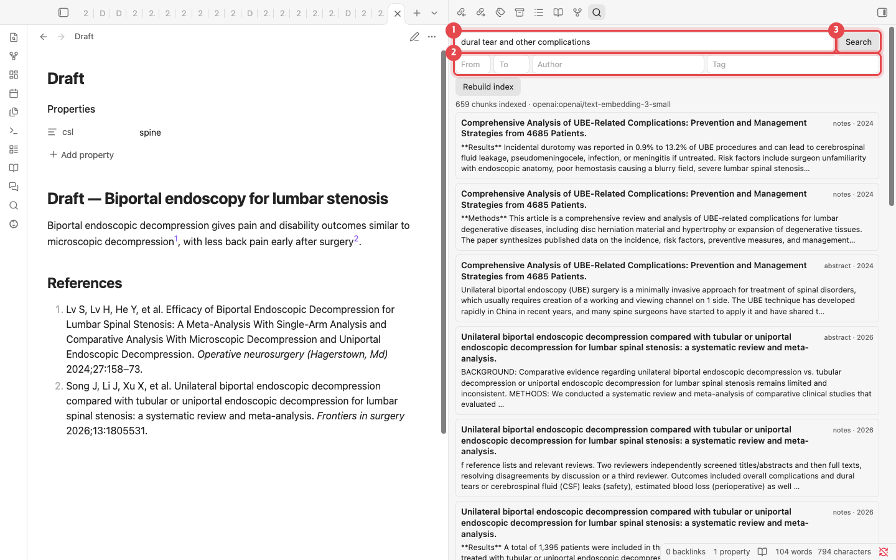

1. Beschreiben Sie, wonach Sie suchen, zum Beispiel `dural tear and other complications`.
2. Grenzen Sie die Ergebnisse nach Jahresbereich, Autor oder Tag ein.
3. Klicken Sie auf **Search**. Die passenden Passagen werden nach Artikeln gruppiert
   aufgelistet; ein Klick darauf öffnet die zugehörige Notiz.

## 8. Mit der Bibliothek chatten

Die Antworten stammen ausschließlich aus den Artikeln, die Sie gesammelt haben. Die Zahlen in
eckigen Klammern, etwa `[1]` und `[3]`, zeigen, aus welchem Artikel die jeweilige Aussage
stammt.

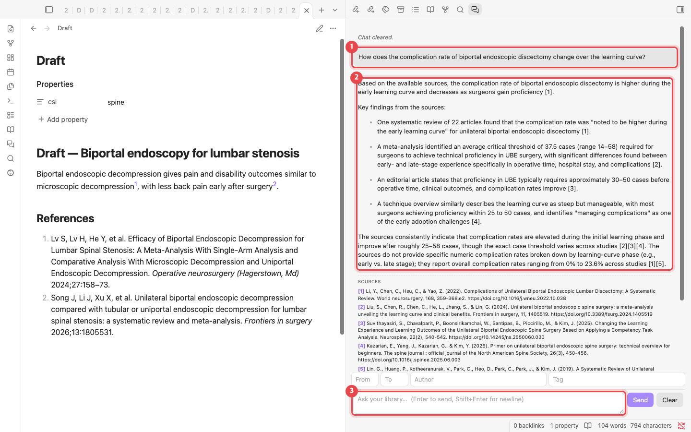

1. Ihre Frage. Sie können in jeder Sprache fragen.
2. Die Antwort. Die Zahlen in eckigen Klammern sind die Quellen.
3. Das Eingabefeld. Mit <kbd>Enter</kbd> senden Sie die Frage ab. Die Felder darüber
   beschränken die Quellen nach Jahr, Autor oder Tag.

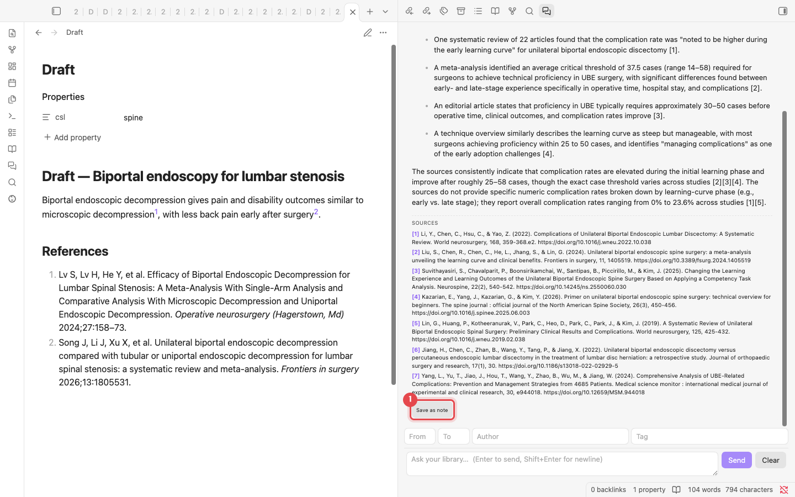

1. **SOURCES** listet die Artikel hinter der Antwort auf. **Save as note** speichert die
   Antwort im Ordner `Chat/` und wandelt die Quellen in `[@citekey]`-Zitate um.

## 9. Verwandte Artikel

Zeigt, wie sich Ihre Artikel gegenseitig zitieren. Klicken Sie einmal auf **Build citation
graph**, um die Zitationsdaten von OpenAlex abzurufen (bei 56 Artikeln etwa 40 Sekunden).

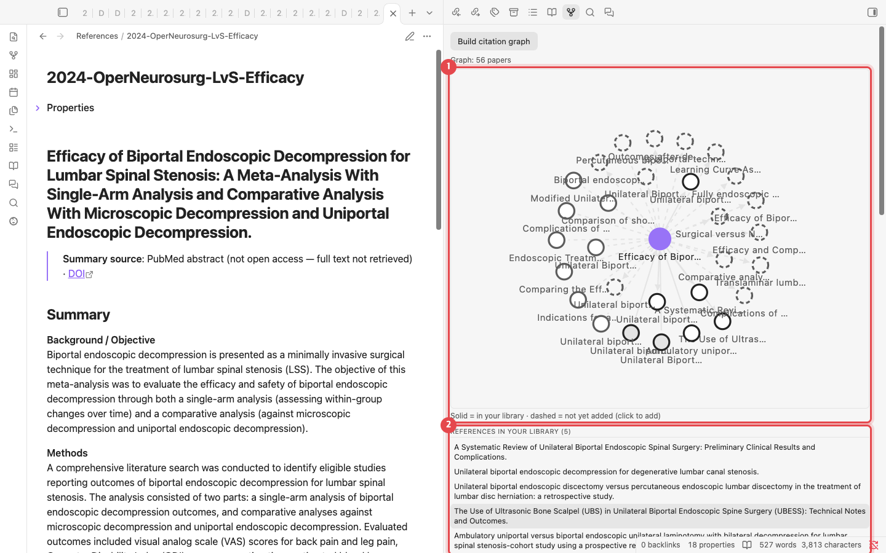

1. **Citation map**: Der violette Punkt ist der geöffnete Artikel. Durchgezogene Kreise sind
   Artikel in Ihrer Bibliothek; gestrichelte Kreise sind Artikel, die Sie noch nicht haben.
   Ein Klick auf einen gestrichelten Kreis fügt ihn hinzu.
2. **Listen**: Artikel, die dieser Artikel zitiert, Artikel, die ihn zitieren, Artikel mit
   vielen gemeinsamen Referenzen und Artikel, die Ihre Bibliothek häufig zitiert, aber nicht
   enthält.
3. **Later papers citing this (OpenAlex)**: Klicken Sie auf **Find newest citing papers**, um die
   neuesten Artikel überhaupt aufzulisten, die den geöffneten Artikel zitieren, mit Jahr und
   Zeitschrift. Zurückgezogene Artikel und Korrekturhinweise sind markiert, Artikel, die schon in Ihrer
   Bibliothek sind, ebenfalls. Ein Klick öffnet den Artikel oder fügt ihn hinzu, falls Sie ihn noch nicht
   haben. Nutzen Sie das vor der Einreichung, damit neuere Arbeit, die eine Schlüsselreferenz
   aktualisiert oder ihr widerspricht, nicht übersehen wird. Angezeigt werden nur Zitationen, die
   OpenAlex indexiert hat; sehr neue Artikel können fehlen. Die Zeilen sind auch mit <kbd>Tab</kbd>
   erreichbar und lassen sich mit <kbd>Enter</kbd> öffnen.

## 10. Manuskript fertigstellen und nach Word exportieren

Alle Befehle finden Sie in der Befehlspalette (<kbd>Cmd/Ctrl</kbd>+<kbd>P</kbd>). Geben Sie
„Refwright“ ein, um sie aufzulisten.

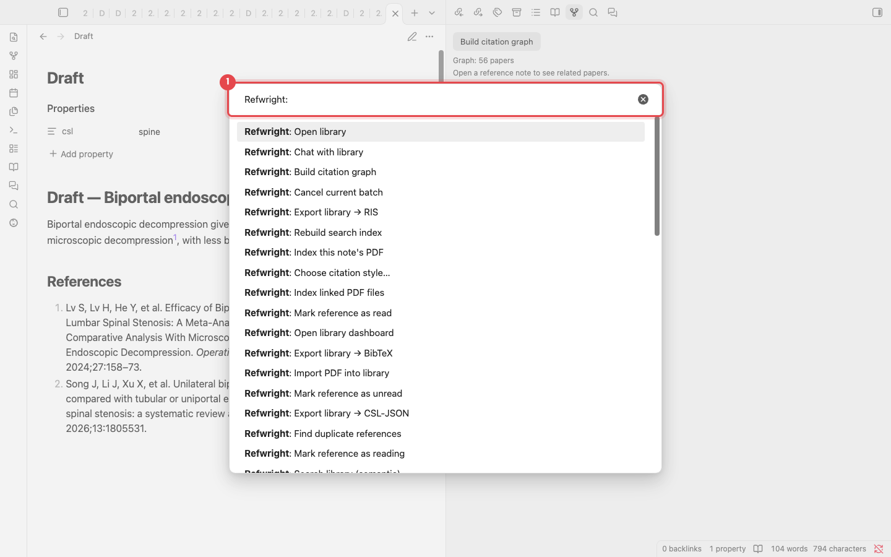

1. Tippen Sie hier einen Teil eines Befehlsnamens. Die am häufigsten genutzten Befehle:

| Befehl | Funktion |
|---|---|
| Update bibliography in current note | Schreibt den Abschnitt „References“ des Manuskripts |
| Compile manuscript | Erstellt eine Kopie, in der `[@citekey]` durch formatierte Zitate ersetzt ist |
| Export manuscript to Word (.docx) | Kompiliert und speichert dann eine Word-Datei (benötigt [Pandoc](https://pandoc.org)) |
| Find unsupported claims | Listet Absätze auf, die eine Aussage ohne Zitat enthalten |
| Suggest citations for selection | Schlägt Artikel für den markierten Satz vor |
| Check references in this manuscript | Listet vor der Einreichung Probleme der zitierten Referenzen auf: zuerst zurückgezogene, dann ohne DOI/PMID, Preprints und fehlende Metadaten, dann Artikel, die nie auf Retraction geprüft wurden oder keine Zusammenfassung haben |

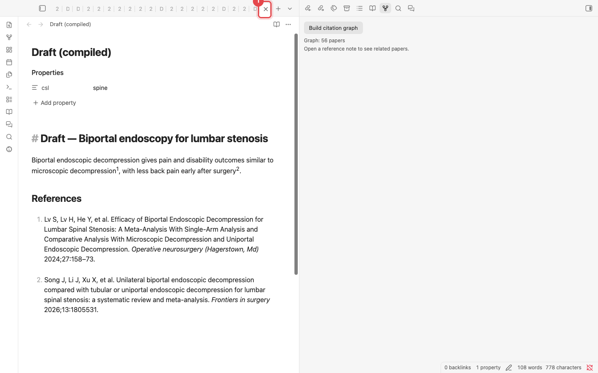

1. **Compile manuscript** lässt das Original unverändert und öffnet eine neue Notiz
   **Draft (compiled)**. Die Zitate sind formatiert und das Literaturverzeichnis ist angehängt,
   bereit zur Einreichung. Für eine Word-Datei führen Sie **Export manuscript to Word (.docx)** aus.

## 11. Systematische Reviews (optional)

Diese Werkzeuge sind für systematische Reviews und Meta-Analysen gedacht. Schalten Sie sie unter
**Settings → Systematic review → Systematic review tools** ein. Eine Bibliothek, die bereits
Screening-Entscheidungen enthält, behält sie eingeschaltet; eine neue Bibliothek startet mit ausgeschalteten
Werkzeugen. Das Ausschalten blendet nur die Befehle aus; alles, was bereits in Ihren Notizen gespeichert
ist, bleibt erhalten.

| Befehl oder Ort | Funktion |
|---|---|
| Open screening pane | Datensätze einzeln screenen: include / exclude / maybe, Schlüsselfragen, Evidenzgrad, Studiendesign, Ausschlussgrund und eine Zeile **Risk of bias** (Tool, Gesamturteil, Notiz). Tastaturkürzel funktionieren durchgehend |
| Search PubMed (import) | Jeder Import schreibt zusätzlich eine Notiz unter `Searches/` mit der genauen Abfrage, dem Datum, den Filtern, der Trefferzahl und den zurückgegebenen und importierten PMIDs, damit die Suche berichtet werden kann (PRISMA-S) |
| Create PRISMA flow diagram | Schreibt die PRISMA-2020-Zahlen und das Diagramm und listet die protokollierten Suchen mit den dadurch identifizierten Datensätzen auf |
| Snowball from included records | Sammelt für jeden eingeschlossenen Datensatz (oder eine Schlüsselfrage) die Artikel, die er zitiert, und die neuesten Artikel, die ihn zitieren, aus OpenAlex, lässt Artikel aus, die schon in Ihrer Bibliothek sind, und schreibt eine gereihte Liste von bis zu 200 Kandidaten zum Screenen |
| Risk-of-bias summary table | Eine Tabelle pro Bewertungstool (RoB 2, ROBINS-I, QUADAS-2, NOS, AMSTAR 2), Anzahl je Urteil und die eingeschlossenen Datensätze, die noch nicht bewertet sind |
| Export evidence table (CSV) | Speichert jeden extrahierten Befund (den Abschnitt *Evidence (extracted)* der Notiz) eines Umfangs als eine CSV-Datei in `Exports/`, mit Referenz- und Screening-Spalten, für R oder RevMan. Werte werden unverändert übernommen; koreanischer Text öffnet sich in Excel korrekt |

Snowball-Kandidaten sind zum Screenen gedacht, nicht zum direkten Zitieren: Fügen Sie einen Artikel hinzu und lesen Sie ihn zuerst.

---

Screenshots: Plugin v0.10.1 in einem Test-Vault mit 56 Artikeln. Die Chat-Antworten sind unbearbeitete
Modellausgaben. Maintainer erzeugen die Screenshots mit `python scripts/manual/capture.py en` neu.
