# Guía del usuario — Refwright

[English](en.md) · [한국어](ko.md) · [中文](zh.md) · [日本語](ja.md) · **Español** · [Deutsch](de.md) · [Français](fr.md) · [Português](pt.md)

Esta guía recorre el complemento paso a paso, desde reunir artículos hasta exportar un manuscrito a Word. Todas las capturas se tomaron usando el complemento real. Los números rojos de cada captura corresponden a los pasos numerados debajo.

**Flujo de trabajo:** reunir artículos → leer y organizar → buscar y preguntar → citar → exportar a Word

**Contenido**

0. [Configuración](#0-configuración)
1. [La pantalla](#1-la-pantalla)
2. [Añadir artículos desde PubMed](#2-añadir-artículos-desde-pubmed)
3. [Añadir un artículo por DOI o PMID](#3-añadir-un-artículo-por-doi-o-pmid)
4. [Notas de referencia](#4-notas-de-referencia)
5. [Explorar la biblioteca](#5-explorar-la-biblioteca)
6. [Citar en tu manuscrito](#6-citar-en-tu-manuscrito)
7. [Búsqueda semántica](#7-búsqueda-semántica)
8. [Chatear con tu biblioteca](#8-chatear-con-tu-biblioteca)
9. [Artículos relacionados](#9-artículos-relacionados)
10. [Terminar el manuscrito y exportarlo a Word](#10-terminar-el-manuscrito-y-exportarlo-a-word)
11. [Revisiones sistemáticas (opcional)](#11-revisiones-sistemáticas-opcional)

---

## 0. Configuración

Instálalo desde **Preferencias → Complementos de la comunidad → Explorar**: busca "Refwright", instálalo y actívalo. Luego introduce tu clave de IA una sola vez.

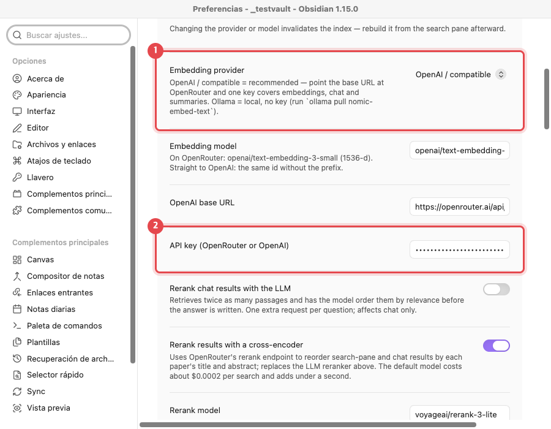

1. Deja **Embedding provider** en `OpenAI / compatible`. La URL base predeterminada es OpenRouter, así que una sola clave cubre búsqueda, chat y resúmenes.
2. Pega tu clave de **OpenRouter** ([openrouter.ai/keys](https://openrouter.ai/keys)) en **API key (OpenRouter or OpenAI)**. La clave se guarda en el llavero del sistema, no en los archivos del vault. También sirve una clave de OpenAI, pero solo si cambias **OpenAI base URL** a `https://api.openai.com/v1`; con la URL predeterminada debe ser una clave de OpenRouter.

> **No hace falta clave para citar.** Añadir artículos, las citas con `@` y las bibliografías funcionan sin clave de IA. La clave solo es necesaria para resúmenes, búsqueda semántica y chat.

## 1. La pantalla

El complemento añade tres iconos a la cinta izquierda y abre un panel de biblioteca a la derecha.

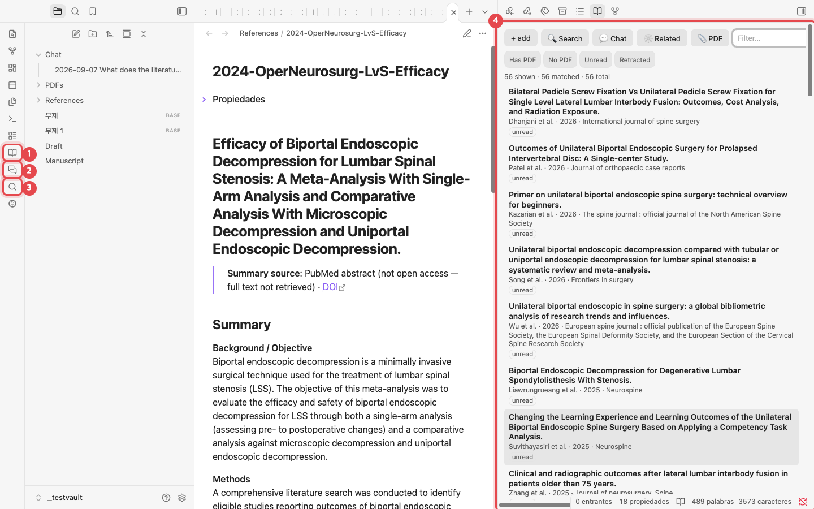

1. **Open library**: abre la lista de tus artículos.
2. **Chat with library**: abre un chat que responde a partir de tus propios artículos.
3. **Search PubMed**: busca en PubMed y añade artículos.
4. **Panel de biblioteca**: cada artículo es una nota. Haz clic en un título para abrir su nota.

## 2. Añadir artículos desde PubMed

La forma más rápida de crear una biblioteca. Busca, marca los artículos que quieras y cada uno se convierte en una nota con resumen y etiquetas de tema.

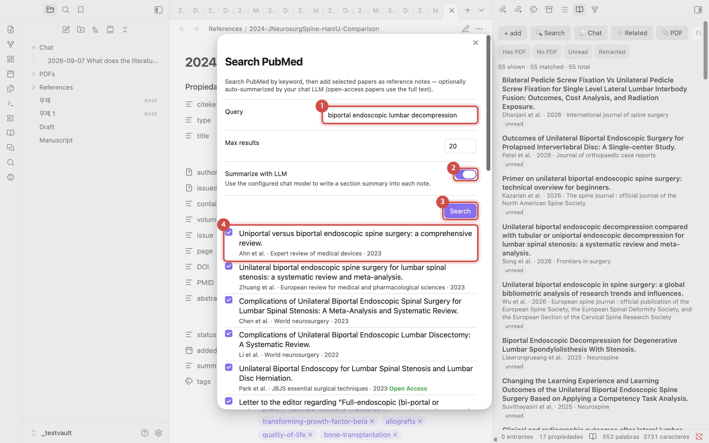

1. Escribe una búsqueda en **Query**, por ejemplo `biportal endoscopic lumbar decompression`.
2. Deja activado **Summarize with LLM** para obtener un resumen por secciones en cada nota. En los artículos de acceso abierto, el resumen se redacta a partir del texto completo.
3. Haz clic en **Search**.
4. Marca los artículos que quieras añadir. Los artículos marcados como **Open Access** se resumen a partir del texto completo.

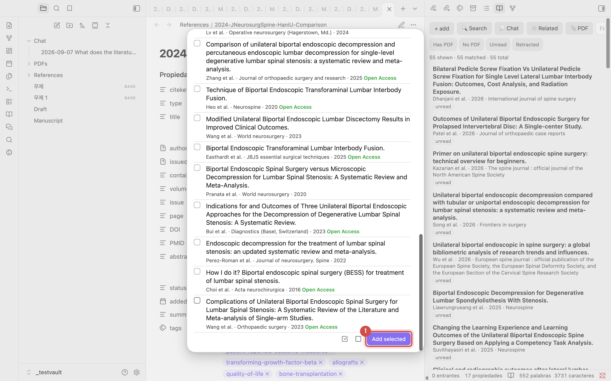

1. Haz clic en **Add selected** al final de la lista. Los dos iconos de al lado seleccionan todo y deseleccionan todo. Cada artículo tarda unos 10–20 segundos; al terminar aparece un aviso "Added 1 reference."

> **Sin duplicados.** Un artículo que ya está en tu biblioteca se reconoce por DOI, PMID o título y no se añade de nuevo.

## 3. Añadir un artículo por DOI o PMID

Cuando ya conoces el artículo, pega su identificador. Haz clic en **+ add** en el panel de biblioteca, o ejecuta "Add reference by DOI / PMID / arXiv" desde la paleta de comandos.

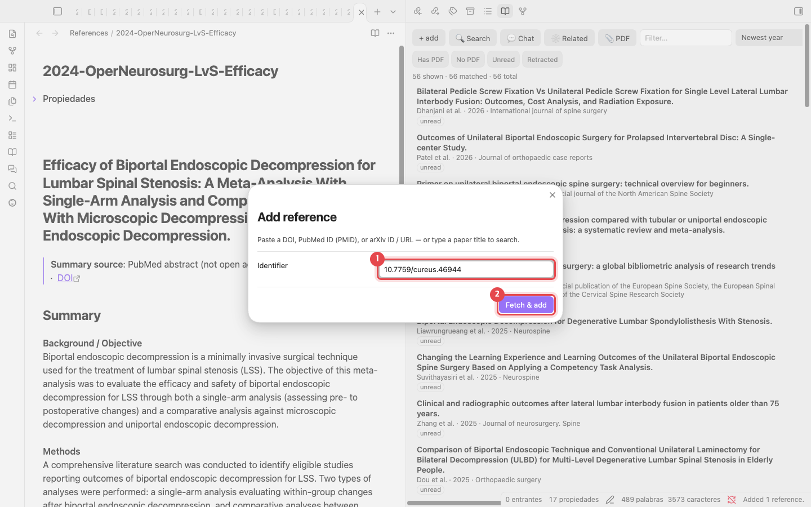

1. Introduce un DOI (`10.7759/cureus.46944`), un PMID (`38021704`) o un ID de arXiv. También funciona el título del artículo; se busca a partir de él.
2. Haz clic en **Fetch & add**. Los metadatos provienen de Crossref y PubMed.

> **¿Tienes un PDF?** Usa **📎 PDF** en el panel de biblioteca para añadir un artículo a partir de su PDF. El DOI que contiene el PDF se usa para completar los metadatos.

## 4. Notas de referencia

Cada artículo se guarda como una nota Markdown en `References/`. Los archivos son la base de datos, así que no hace falta un programa aparte como Zotero.

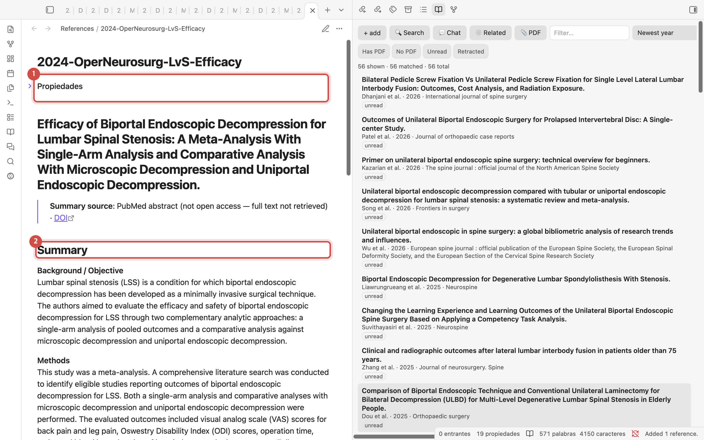

1. **Propiedades**: autores, año, revista, DOI, PMID y etiquetas (a partir de MeSH). La clave usada para citar, el `citekey` (por ejemplo `lv2024efficacy`), también está aquí.
2. **Summary**: Background, Methods, Results y Conclusions. Escribe tus propias notas más abajo, en **Notes**.

## 5. Explorar la biblioteca

Filtra el panel de biblioteca a medida que crece.

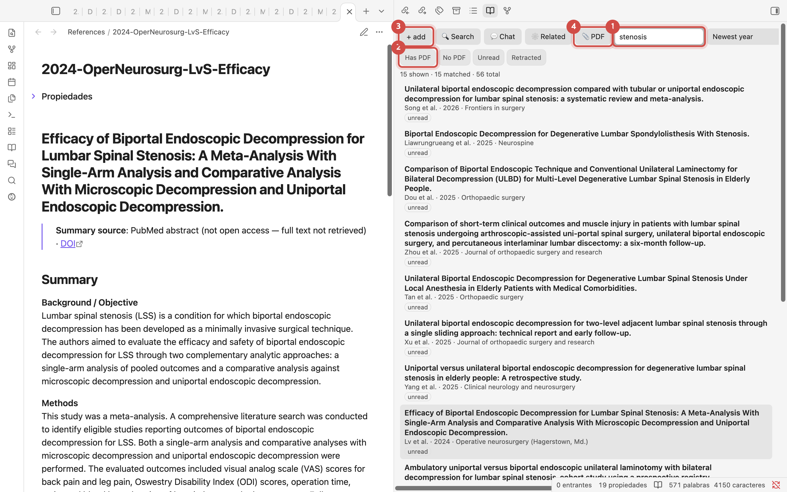

1. **Filter**: busca coincidencias en títulos, autores y etiquetas. Escribir `stenosis` deja 15 de 56 artículos. El menú de la derecha cambia el orden (por ejemplo, año más reciente primero).
2. **Filtros rápidos**: muestra solo artículos con PDF, sin PDF, sin leer o retractados.
3. **+ add**: abre el diálogo de DOI / PMID (sección 3).
4. **📎 PDF**: añade un artículo a partir de un archivo PDF.

## 6. Citar en tu manuscrito

Escribe tu manuscrito en una nota normal. Escribe `@` donde deba ir una cita.

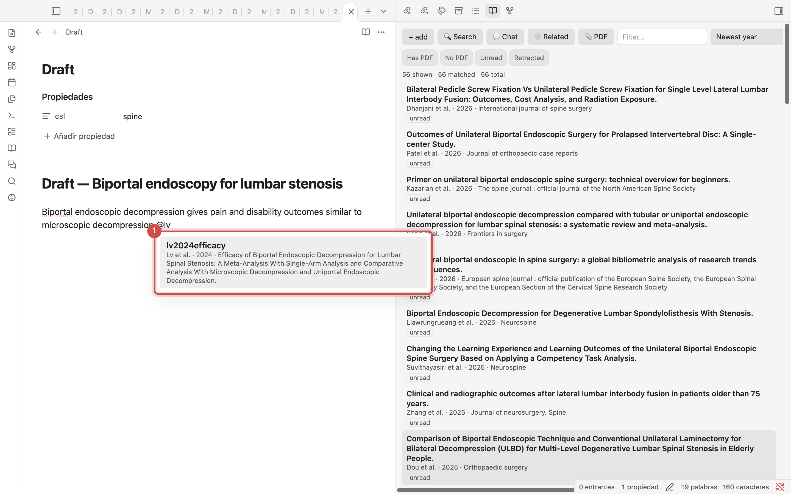

1. Después de `@`, escribe parte del nombre de un autor o del título para ver los artículos que coinciden. Pulsa <kbd>Enter</kbd> para insertar `[@lv2024efficacy]`.

### Generar la bibliografía

Pon el estilo de la revista en las propiedades de la nota (`csl: spine`) y ejecuta <kbd>Cmd/Ctrl</kbd>+<kbd>P</kbd> → **Update bibliography in current note**.

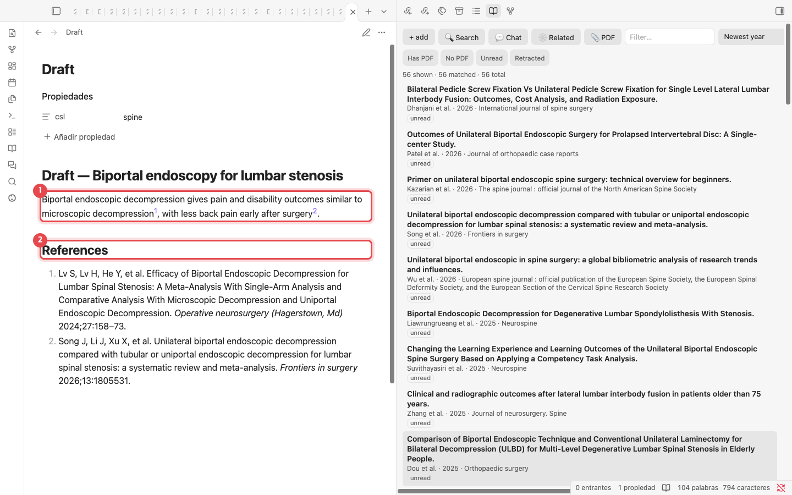

1. En la vista de lectura, cada `[@citekey]` se muestra con el estilo de la revista (aquí, números en superíndice).
2. Al final de la nota se escribe una sección **References** con el formato de la revista. Vuelve a ejecutar el comando después de añadir o quitar citas para actualizarla.

> **Estilos de revista**: `spine`, `apa`, `american-medical-association`, `elsevier-vancouver` y `springer-basic-brackets` vienen integrados. Cualquier otro ID de estilo del [repositorio de estilos CSL](https://github.com/citation-style-language/styles), como `vancouver` o `nature`, se descarga la primera vez que se usa. ¿No conoces el ID? Ejecuta **Choose citation style…** y escribe el nombre de la revista.

## 7. Búsqueda semántica

Encuentra pasajes con un significado similar, incluso cuando las palabras son distintas. Ábrela con **Search** en el panel de biblioteca. Haz clic una vez en **Rebuild index** primero (menos de un minuto para unos 50 artículos).

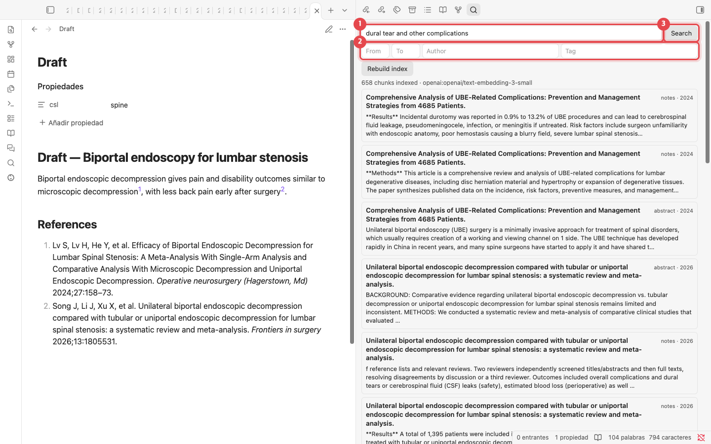

1. Describe lo que buscas, por ejemplo `dural tear and other complications`.
2. Acota los resultados por rango de años, autor o etiqueta.
3. Haz clic en **Search**. Los pasajes coincidentes se listan por artículo; haz clic en uno para abrir su nota.

## 8. Chatear con tu biblioteca

Las respuestas provienen solo de los artículos que has reunido. Los números entre corchetes, como `[1]` y `[3]`, indican de qué artículo procede cada afirmación.

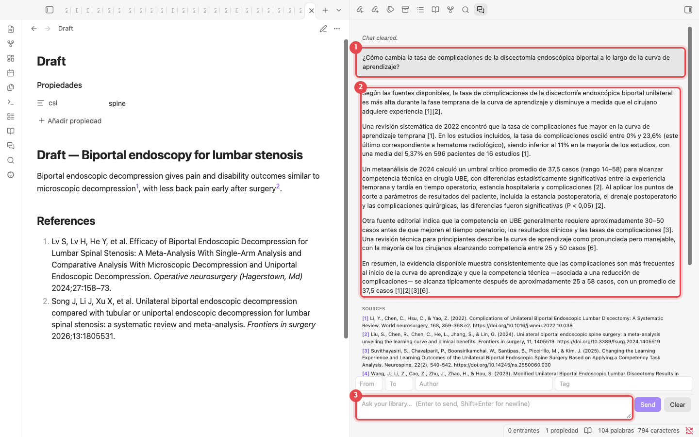

1. Tu pregunta. Puedes preguntar en cualquier idioma.
2. La respuesta. Los números entre corchetes son las fuentes.
3. El cuadro de la pregunta. Pulsa <kbd>Enter</kbd> para enviarla. Los campos de arriba limitan las fuentes por año, autor o etiqueta.

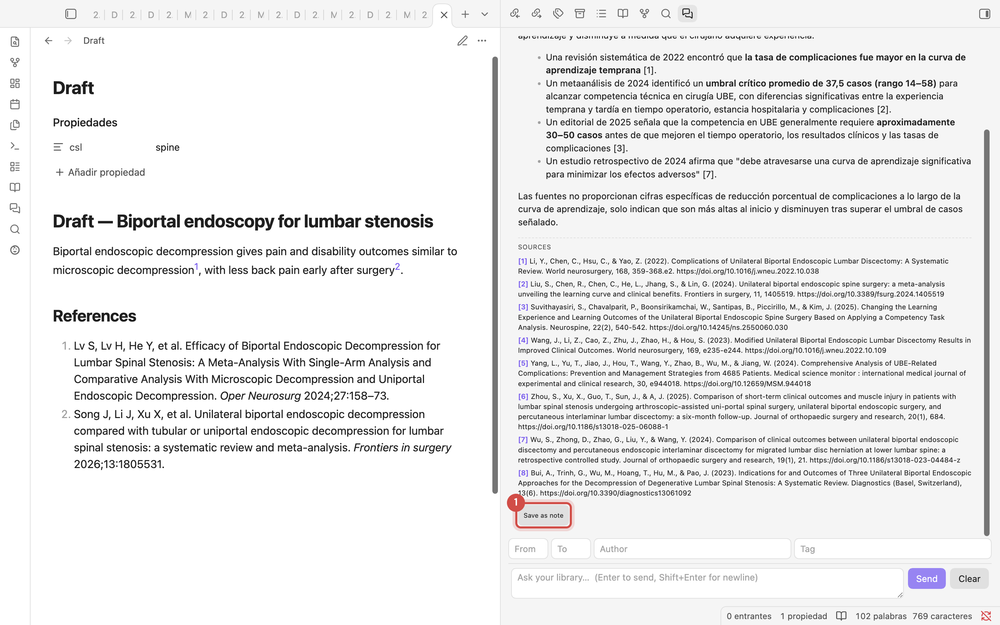

1. **SOURCES** lista los artículos detrás de la respuesta. **Save as note** guarda la respuesta en la carpeta `Chat/` y convierte las fuentes en citas `[@citekey]`.

## 9. Artículos relacionados

Muestra cómo se citan entre sí tus artículos. Haz clic una vez en **Build citation graph** para obtener los datos de citas desde OpenAlex (unos 40 segundos para 56 artículos).

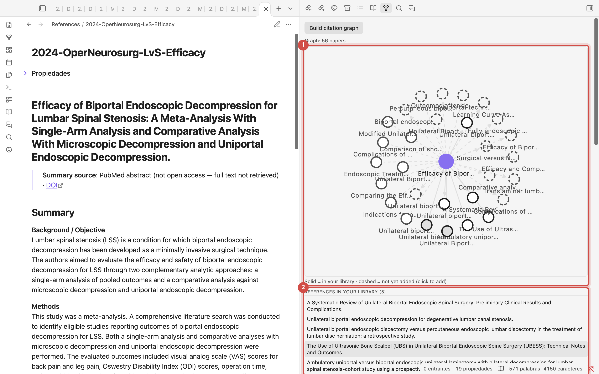

1. **Mapa de citas**: el punto morado es el artículo abierto. Los círculos sólidos son artículos de tu biblioteca; los círculos discontinuos son artículos que aún no tienes. Haz clic en un círculo discontinuo para añadirlo.
2. **Listas**: artículos que este cita, artículos que lo citan, artículos que comparten muchas referencias con él, y artículos que tu biblioteca cita a menudo pero que no contiene.

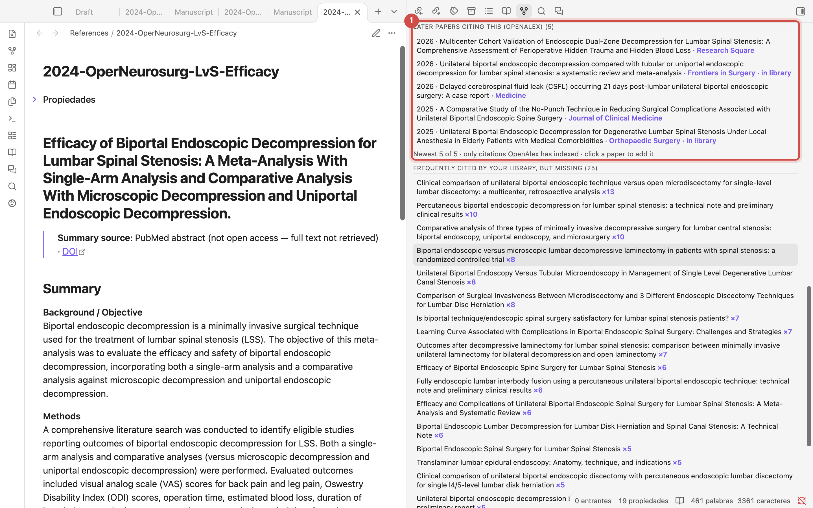

1. **Artículos posteriores que citan este (OpenAlex)**: haz clic en **Find newest citing papers** para listar los
   artículos más recientes, de cualquier procedencia, que citan el artículo abierto, con año y revista. Los artículos retractados y
   los avisos de corrección aparecen señalados, y los que ya están en tu biblioteca se marcan. Haz clic en un artículo
   para abrirlo, o para añadirlo si no lo tienes. Úsalo antes del envío, para no perder trabajos nuevos que
   actualicen o contradigan una referencia clave. Solo se muestran las citas que OpenAlex ha indexado; los artículos muy
   recientes pueden faltar. También se llega a las filas con <kbd>Tab</kbd> y se abren con <kbd>Enter</kbd>.

## 10. Terminar el manuscrito y exportarlo a Word

Todos los comandos están en la paleta de comandos (<kbd>Cmd/Ctrl</kbd>+<kbd>P</kbd>). Escribe "Refwright" para listarlos.

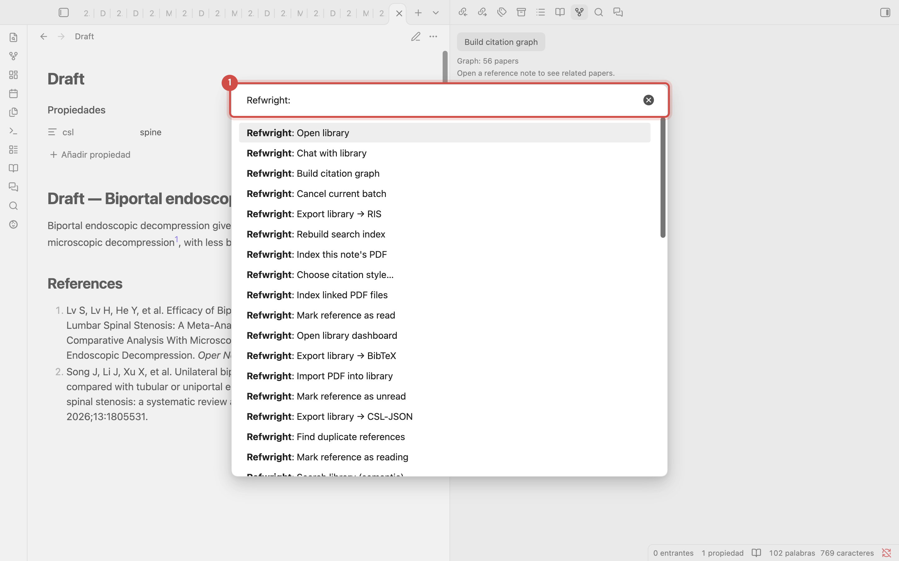

1. Escribe aquí parte del nombre de un comando. Los comandos más usados:

| Comando | Qué hace |
|---|---|
| Update bibliography in current note | Escribe la sección References del manuscrito |
| Compile manuscript | Crea una copia con `[@citekey]` reemplazado por citas formateadas |
| Export manuscript to Word (.docx) | Compila y luego guarda un archivo Word (necesita [Pandoc](https://pandoc.org)) |
| Find unsupported claims | Lista párrafos que hacen una afirmación sin cita |
| Suggest citations for selection | Sugiere artículos para la frase seleccionada |
| Check references in this manuscript | Lista los problemas de las referencias citadas antes del envío: primero las retractadas, luego las que no tienen DOI/PMID, los preprints y los metadatos que faltan, y después los artículos nunca comprobados por retractación o sin resumen |

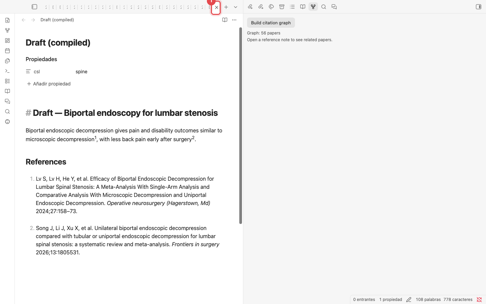

1. **Compile manuscript** deja el original intacto y abre una nota nueva, **Draft (compiled)**. Las citas quedan formateadas y la lista de referencias adjunta, lista para enviarla. Para un archivo Word, ejecuta **Export manuscript to Word (.docx)**.

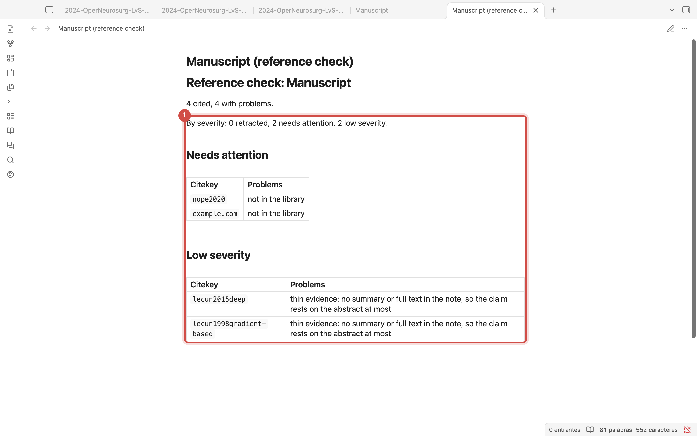

1. El informe se abre como una nota nueva, **nombre del manuscrito (reference check)**, junto al manuscrito. Los problemas se agrupan por gravedad: primero **Retracted**, luego **Needs attention** (no está en la biblioteca, sin DOI ni PMID, preprint, metadatos que faltan) y por último **Low severity** (nunca se comprobó si fue retractado, o la nota no tiene resumen ni texto completo). Resuelve los dos primeros grupos antes de enviar.

> **Prefijos y localizadores de página.** **Compile manuscript** y la exportación a Word conservan el prefijo y el localizador de página de una cita, de modo que `[see @lv2024efficacy, p. 23]` se compila con «see» y el número de página intactos.

> **Resúmenes antiguos.** **Re-summarize references made by an older model** pregunta, antes de empezar, de qué modelo rehacer los resúmenes (con el recuento por modelo). Los resúmenes hechos con el texto completo de un PDF no se tocan.

## 11. Revisiones sistemáticas (opcional)

Estas herramientas son para revisiones sistemáticas y metanálisis. Actívalas en
**Settings → Systematic review → Systematic review tools**. Una biblioteca que ya tiene decisiones de cribado
las mantiene activadas; una biblioteca nueva empieza con ellas desactivadas. Desactivarlas solo oculta los
comandos; todo lo que ya esté guardado en tus notas permanece.

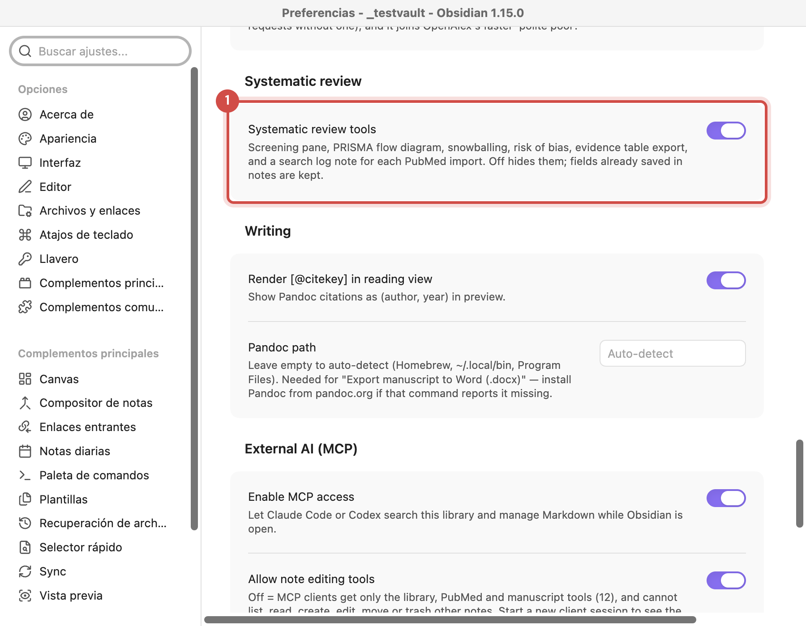

1. Activa **Systematic review tools**. Los comandos de abajo aparecen entonces en la paleta de comandos.

| Comando o lugar | Qué hace |
|---|---|
| Open screening pane | Criba un registro cada vez: include / exclude / maybe, preguntas clave, nivel de evidencia, diseño, motivo de exclusión y una fila **Risk of bias** (herramienta, juicio global, nota). Los atajos de teclado funcionan en todo momento |
| Search PubMed (import) | Cada importación escribe también una nota en `Searches/` con la consulta exacta, la fecha, los filtros, el número de resultados y los PMID devueltos e importados, para poder informar de la búsqueda (PRISMA-S) |
| Create PRISMA flow diagram | Escribe los recuentos y el diagrama PRISMA 2020, y lista las búsquedas registradas con los registros que identificaron |
| Snowball from included records | Para cada registro incluido (o una pregunta clave), reúne los artículos que cita y los artículos más recientes que lo citan desde OpenAlex, omite los que ya están en tu biblioteca y escribe una lista ordenada de hasta 200 candidatos para cribar |
| Study (Screening pane) | Da el mismo study id a todos los informes de un mismo estudio (protocolo, informe principal, seguimiento, corrección). El panel lista los demás informes de ese estudio y el diagrama PRISMA pasa a contar por separado informes y estudios. Las notas no se fusionan |
| Risk-of-bias summary table | Una tabla por herramienta de evaluación (RoB 2, ROBINS-I, QUADAS-2, NOS, AMSTAR 2), recuentos por juicio y los registros incluidos que aún no se han evaluado |
| Export evidence table (CSV) | Guarda todos los hallazgos extraídos (la sección *Evidence (extracted)* de la nota) de un ámbito en un único CSV en `Exports/`, con columnas de referencia y de cribado, para R o RevMan. Los valores se copian tal como están escritos; el texto coreano se abre correctamente en Excel |

Ejecuta **Open screening pane** para cribar la biblioteca registro a registro.

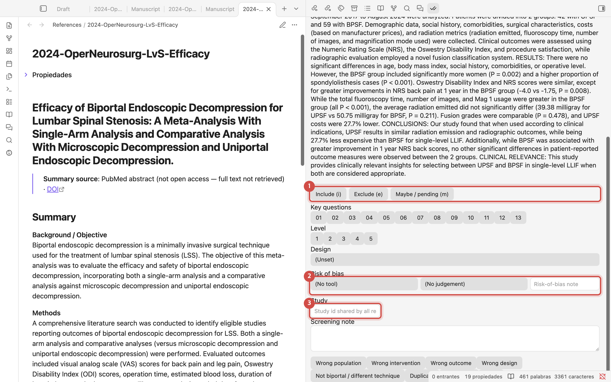

1. Los botones de decisión: **Include (i)**, **Exclude (e)** o **Maybe / pending (m)**; las letras son atajos de teclado. Include necesita al menos una pregunta clave.
2. **Risk of bias**: la herramienta de evaluación, el juicio global y una nota breve. **Risk-of-bias summary table** los reúne.
3. **Study**: da el mismo id a todos los informes de un estudio. El panel muestra entonces los demás informes de ese estudio y el diagrama PRISMA cuenta por separado informes y estudios.

Ejecuta **Snowball from included records…**, elige todos los registros incluidos o una pregunta clave, y el resultado se abre como una nota.

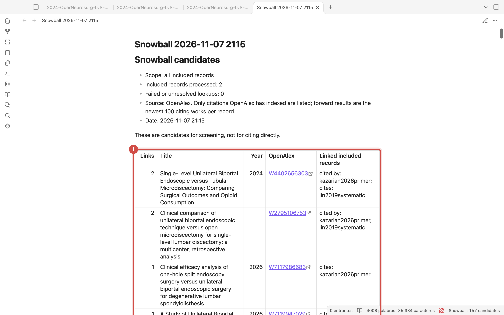

1. La tabla ordena los candidatos por **Links**, el número de registros incluidos que los citan o a los que citan. **Linked included records** los nombra. Los artículos que ya están en tu biblioteca se omiten; la nota contiene hasta 200 candidatos.

Los candidatos de snowballing son para cribar, no para citar directamente: añade un artículo y léelo primero.

---

Capturas de pantalla: complemento v0.11.3 en una biblioteca de prueba de 56 artículos. Las respuestas del chat son la salida del modelo sin editar. Los mantenedores regeneran las capturas con `python scripts/manual/capture.py es`.
