# Guide d'utilisation — Refwright

[English](en.md) · [한국어](ko.md) · [中文](zh.md) · [日本語](ja.md) · [Español](es.md) · [Deutsch](de.md) · **Français** · [Português](pt.md)

Ce guide présente le plugin de la collecte des articles à l'export d'un manuscrit Word.
Chaque capture d'écran provient du véritable plugin. Les numéros rouges de chaque capture correspondent
aux étapes numérotées qui la suivent.

**Flux de travail :** collecter les articles → lire et organiser → rechercher et interroger → citer → exporter vers Word

**Sommaire**

0. [Configuration](#0-configuration)
1. [Interface](#1-interface)
2. [Ajouter des articles depuis PubMed](#2-ajouter-des-articles-depuis-pubmed)
3. [Ajouter un article par DOI ou PMID](#3-ajouter-un-article-par-doi-ou-pmid)
4. [Notes de référence](#4-notes-de-référence)
5. [Parcourir la bibliothèque](#5-parcourir-la-bibliothèque)
6. [Citer dans votre manuscrit](#6-citer-dans-votre-manuscrit)
7. [Recherche sémantique](#7-recherche-sémantique)
8. [Dialoguer avec votre bibliothèque](#8-dialoguer-avec-votre-bibliothèque)
9. [Articles associés](#9-articles-associés)
10. [Terminer le manuscrit et exporter vers Word](#10-terminer-le-manuscrit-et-exporter-vers-word)
11. [Revues systématiques (facultatif)](#11-revues-systématiques-facultatif)

---

## 0. Configuration

Installez le plugin depuis **Settings → Community plugins → Browse** : recherchez « Refwright », installez-le et activez-le. Saisissez ensuite une seule fois votre clé d'IA.

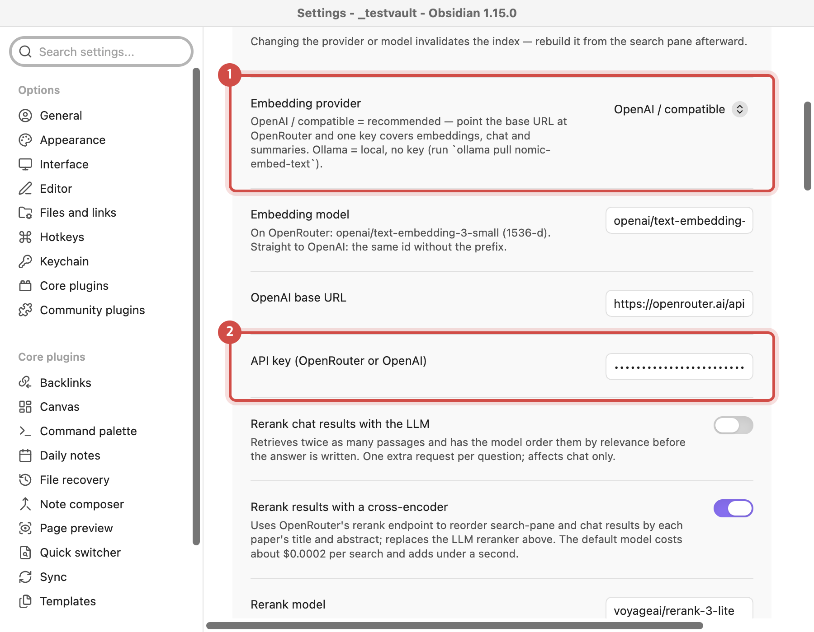

1. Laissez **Embedding provider** sur `OpenAI / compatible`. L'URL de base par défaut est
   celle d'OpenRouter : une seule clé couvre donc la recherche, le chat et les résumés.
2. Collez votre clé **OpenRouter** ([openrouter.ai/keys](https://openrouter.ai/keys)) dans **API key (OpenRouter or OpenAI)**. La clé est conservée dans le trousseau
   de votre système, et non dans les fichiers du vault. Une clé OpenAI fonctionne aussi, mais
   seulement si vous remplacez **OpenAI base URL** par `https://api.openai.com/v1` ; avec l'URL
   par défaut, il faut une clé OpenRouter.

> **Aucune clé n'est nécessaire pour citer.** L'ajout d'articles, les citations `@` et les bibliographies fonctionnent tous
> sans clé d'IA. La clé ne sert qu'aux résumés, à la recherche sémantique et au chat.

## 1. Interface

Le plugin ajoute trois icônes à la barre latérale gauche et un panneau de bibliothèque à droite.

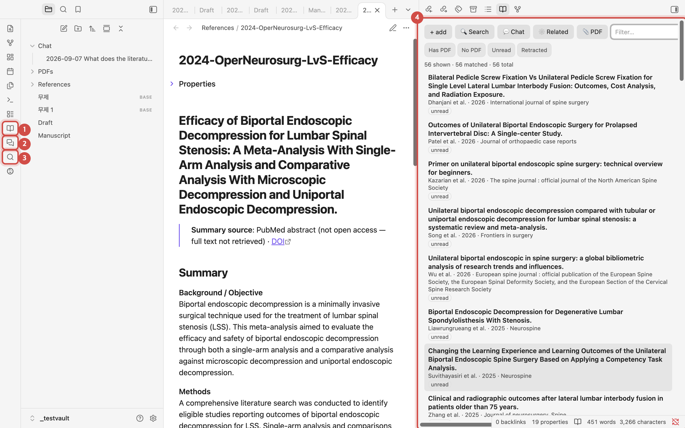

1. **Open library** : ouvre la liste de vos articles.
2. **Chat with library** : ouvre un chat qui répond à partir de vos propres articles.
3. **Search PubMed** : interroge PubMed et ajoute des articles.
4. **Panneau de la bibliothèque** : chaque article est une note. Cliquez sur un titre pour ouvrir sa note.

## 2. Ajouter des articles depuis PubMed

La façon la plus rapide de constituer une bibliothèque. Lancez une recherche, cochez les articles voulus, et chacun devient une
note dotée d'un résumé et de tags thématiques.

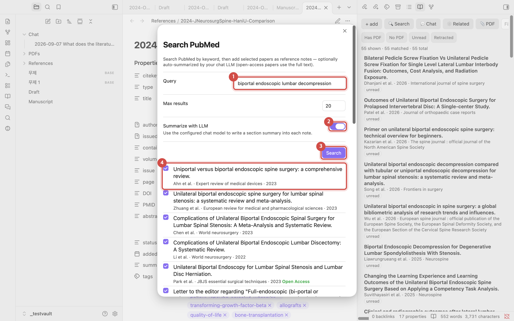

1. Saisissez une recherche dans **Query**, par exemple `biportal endoscopic lumbar decompression`.
2. Laissez **Summarize with LLM** activé pour obtenir dans chaque note un résumé section par section. Pour les
   articles en accès libre, le résumé est rédigé à partir du texte intégral.
3. Cliquez sur **Search**.
4. Cochez les articles à ajouter. Les articles marqués **Open Access** sont résumés à partir du texte intégral.

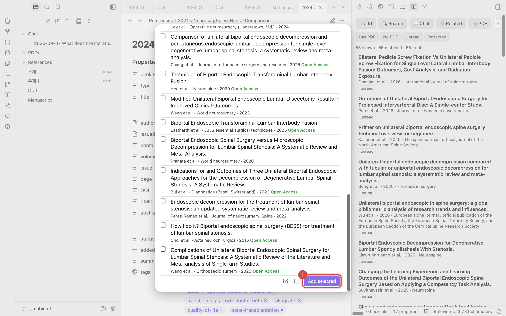

1. Cliquez sur **Add selected** au bas de la liste. Les deux icônes situées à côté permettent de tout sélectionner
   et de tout désélectionner. Chaque article demande environ 10 à 20 secondes ; une notification « Added 1 reference. »
   s'affiche une fois l'opération terminée.

> **Pas de doublons.** Un article déjà présent dans votre bibliothèque est reconnu par son DOI, son PMID ou
> son titre et n'est pas ajouté une seconde fois.

## 3. Ajouter un article par DOI ou PMID

Lorsque vous connaissez l'article, collez son identifiant. Cliquez sur **+ add** dans le panneau de la bibliothèque, ou lancez
« Add reference by DOI / PMID / arXiv » depuis la palette de commandes.

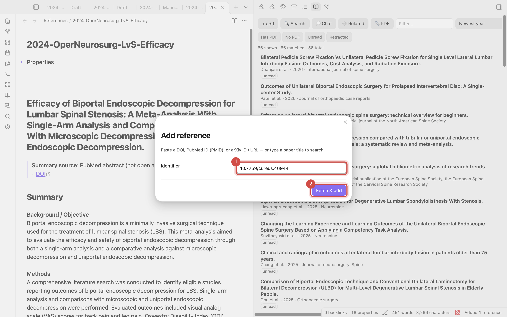

1. Saisissez un DOI (`10.7759/cureus.46944`), un PMID (`38021704`) ou un identifiant arXiv. Un titre d'article
   fonctionne aussi ; il est alors recherché.
2. Cliquez sur **Fetch & add**. Les métadonnées proviennent de Crossref et de PubMed.

> **Vous avez un PDF ?** Utilisez **📎 PDF** dans le panneau de la bibliothèque pour ajouter un article à partir de son PDF. Le DOI
> contenu dans le PDF sert à renseigner les métadonnées.

## 4. Notes de référence

Chaque article est enregistré sous forme de note Markdown dans `References/`. Ces fichiers sont la base de données ; il n'y a donc
aucun programme distinct tel que Zotero.

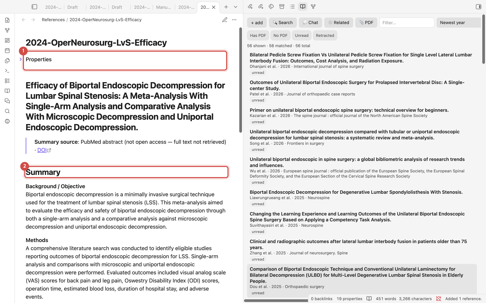

1. **Properties** : auteurs, année, revue, DOI, PMID et tags (issus de MeSH). La clé utilisée pour
   citer, le `citekey` (par exemple `lv2024efficacy`), s'y trouve aussi.
2. **Summary** : Background, Methods, Results et Conclusions. Rédigez vos propres remarques sous
   **Notes**, plus bas.

## 5. Parcourir la bibliothèque

Filtrez le panneau de la bibliothèque à mesure qu'elle s'étoffe.

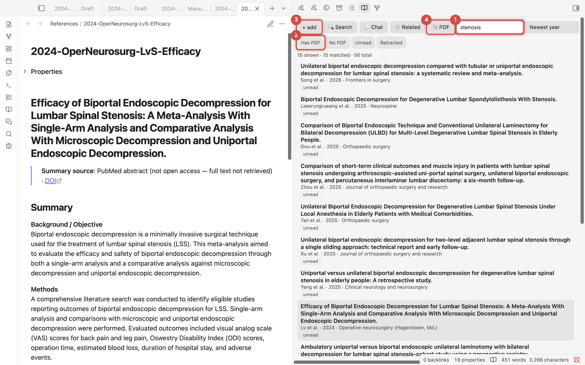

1. **Filter** : recherche dans les titres, les auteurs et les tags. Saisir `stenosis` ne laisse que 15 articles sur 56.
   Le menu situé à droite modifie l'ordre de tri (par exemple l'année la plus récente d'abord).
2. **Quick filters** : n'affichent que les articles avec un PDF, sans PDF, non lus ou rétractés.
3. **+ add** : ouvre la boîte de dialogue DOI / PMID (section 3).
4. **📎 PDF** : ajoute un article à partir d'un fichier PDF.

## 6. Citer dans votre manuscrit

Rédigez votre manuscrit dans une note ordinaire. Tapez `@` là où une citation doit apparaître.

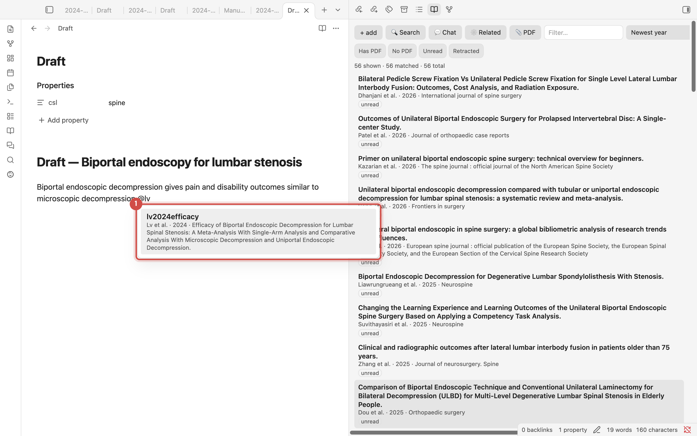

1. Après `@`, saisissez une partie d'un nom d'auteur ou d'un titre pour voir les articles correspondants. Appuyez sur
   <kbd>Enter</kbd> pour insérer `[@lv2024efficacy]`.

### Construire la bibliographie

Indiquez le style de la revue dans les propriétés de la note (`csl: spine`), puis lancez
<kbd>Cmd/Ctrl</kbd>+<kbd>P</kbd> → **Update bibliography in current note**.

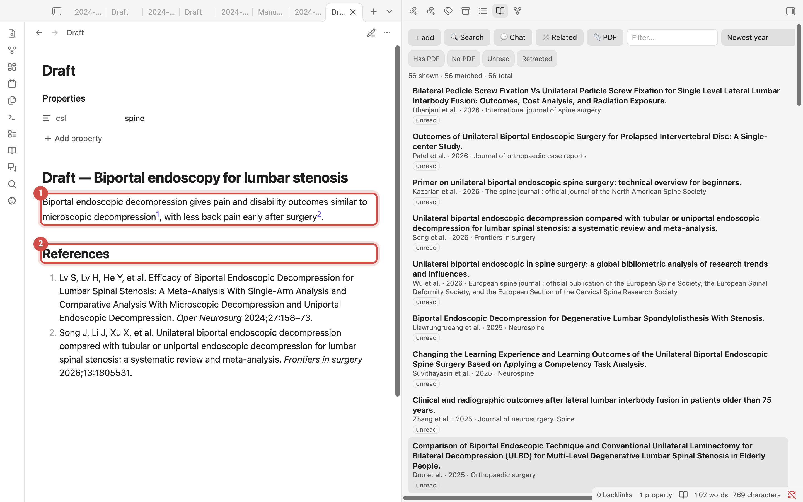

1. En mode lecture, chaque `[@citekey]` s'affiche dans le style de la revue (ici, des numéros
   en exposant).
2. Une section **References** est écrite à la fin de la note dans le format de la revue. Relancez
   la commande après avoir ajouté ou retiré des citations pour la mettre à jour.

> **Styles de revues** : `spine`, `apa`, `american-medical-association`, `elsevier-vancouver`
> et `springer-basic-brackets` sont intégrés. Tout autre identifiant de style du
> [dépôt de styles CSL](https://github.com/citation-style-language/styles), tel que
> `vancouver` ou `nature`, est téléchargé à la première utilisation. Vous ne connaissez pas l'identifiant ? Lancez **Choose citation
> style…** et saisissez le nom de la revue.

## 7. Recherche sémantique

Trouve des passages de sens proche, même lorsque les mots diffèrent. Ouvrez-la avec **Search**
dans le panneau de la bibliothèque. Cliquez d'abord une fois sur **Rebuild index** (moins d'une minute pour environ 50 articles).

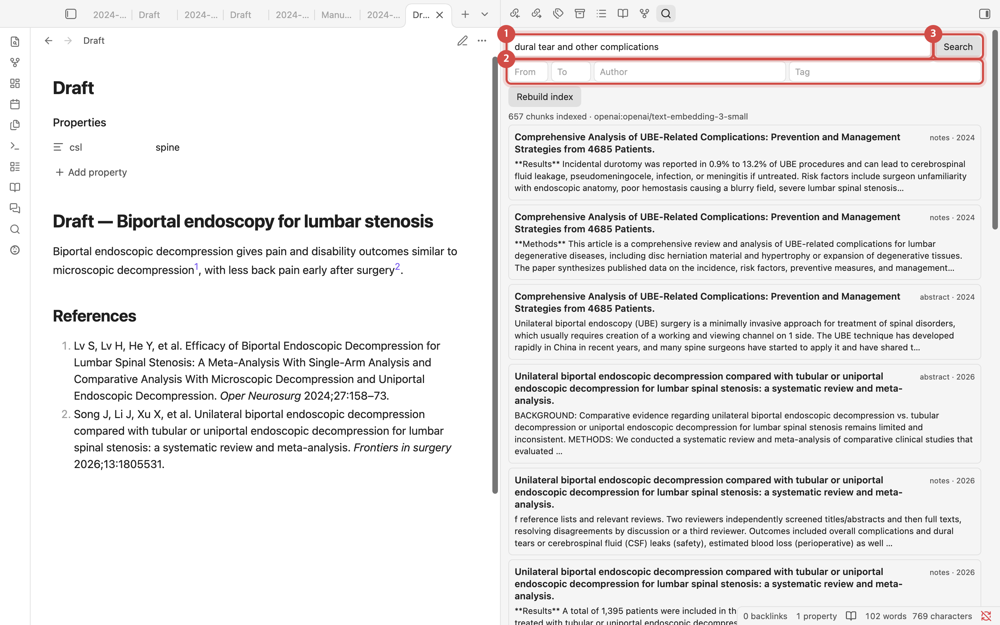

1. Décrivez ce que vous cherchez, par exemple `dural tear and other complications`.
2. Affinez les résultats par période, auteur ou tag.
3. Cliquez sur **Search**. Les passages correspondants sont listés par article ; cliquez sur l'un d'eux pour ouvrir sa note.

## 8. Dialoguer avec votre bibliothèque

Les réponses proviennent uniquement des articles que vous avez collectés. Les numéros entre crochets, tels que `[1]` et
`[3]`, indiquent de quel article provient chaque affirmation.

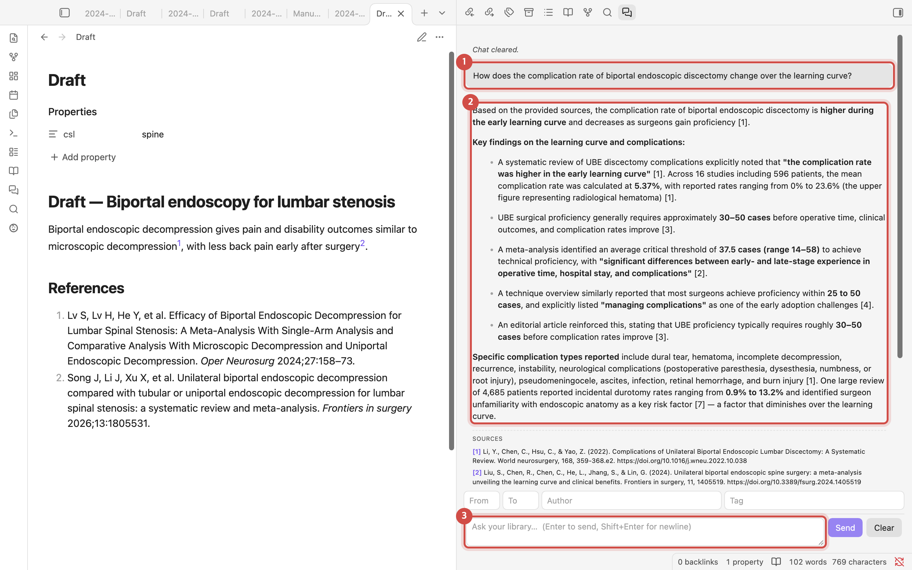

1. Votre question. Vous pouvez la poser dans n'importe quelle langue.
2. La réponse. Les numéros entre crochets sont les sources.
3. La zone de saisie de la question. Appuyez sur <kbd>Enter</kbd> pour envoyer. Les champs au-dessus limitent les sources
   par année, auteur ou tag.

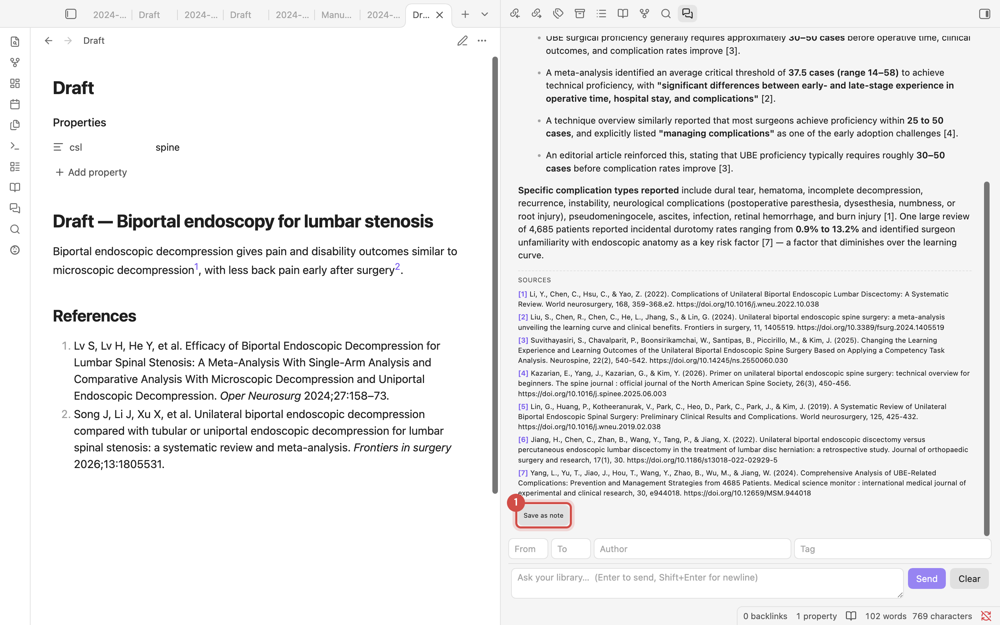

1. **SOURCES** liste les articles sur lesquels repose la réponse. **Save as note** enregistre la réponse dans le
   dossier `Chat/` et transforme les sources en citations `[@citekey]`.

## 9. Articles associés

Montre comment vos articles se citent les uns les autres. Cliquez une fois sur **Build citation graph** pour récupérer les
données de citation depuis OpenAlex (environ 40 secondes pour 56 articles).

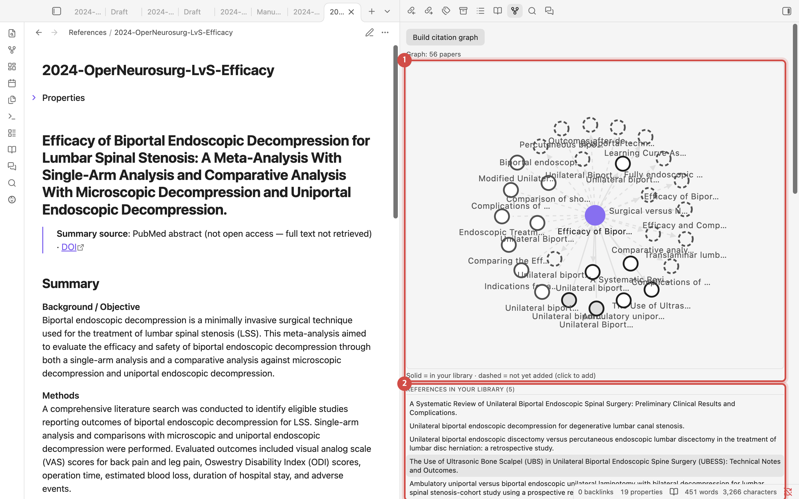

1. **Carte des citations** : le point violet est l'article ouvert. Les cercles pleins sont des articles de votre
   bibliothèque ; les cercles en pointillés sont des articles que vous ne possédez pas encore. Cliquez sur un cercle en pointillés pour l'ajouter.
2. **Listes** : articles cités par celui-ci, articles qui le citent, articles qui partagent de nombreuses
   références avec lui, et articles que votre bibliothèque cite souvent mais ne contient pas.

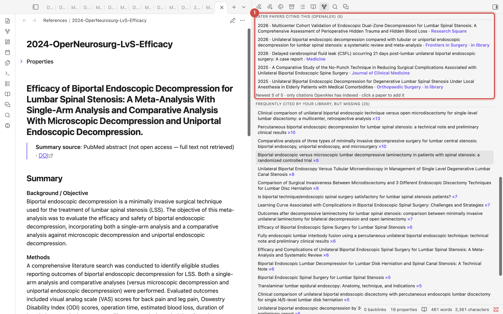

1. **Articles plus récents qui citent celui-ci (OpenAlex)** : cliquez sur **Find newest citing papers** pour lister
   les articles les plus récents, où qu'ils soient, qui citent l'article ouvert, avec l'année et la revue. Les
   articles rétractés et les avis de correction sont signalés, et ceux déjà présents dans votre bibliothèque sont
   marqués. Cliquez sur un article pour l'ouvrir, ou pour l'ajouter si vous ne l'avez pas. Utilisez-le avant la
   soumission, pour ne pas manquer un travail plus récent qui met à jour ou contredit une référence clé. Seules
   les citations indexées par OpenAlex sont affichées ; les articles très récents peuvent manquer. On peut aussi
   atteindre les lignes avec <kbd>Tab</kbd> et les ouvrir avec <kbd>Entrée</kbd>.

## 10. Terminer le manuscrit et exporter vers Word

Toutes les commandes se trouvent dans la palette de commandes (<kbd>Cmd/Ctrl</kbd>+<kbd>P</kbd>). Tapez
« Refwright » pour les lister.

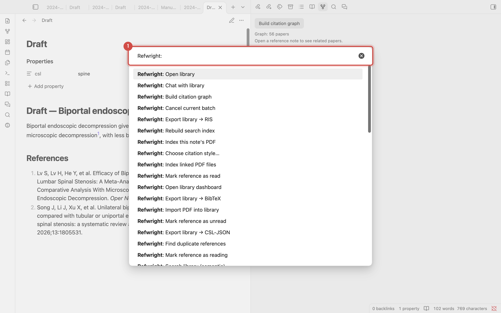

1. Saisissez ici une partie du nom d'une commande. Les commandes les plus utilisées :

| Commande | Fonction |
|---|---|
| Update bibliography in current note | Écrit la section References du manuscrit |
| Compile manuscript | Crée une copie où `[@citekey]` est remplacé par des citations mises en forme |
| Export manuscript to Word (.docx) | Compile, puis enregistre un fichier Word (nécessite [Pandoc](https://pandoc.org)) |
| Find unsupported claims | Liste les paragraphes qui avancent une affirmation sans citation |
| Suggest citations for selection | Suggère des articles pour la phrase sélectionnée |
| Check references in this manuscript | Liste les problèmes des références citées avant la soumission : d'abord les articles rétractés, puis l'absence de DOI/PMID, les preprints et les métadonnées manquantes, puis les articles jamais vérifiés pour rétractation ou sans résumé |

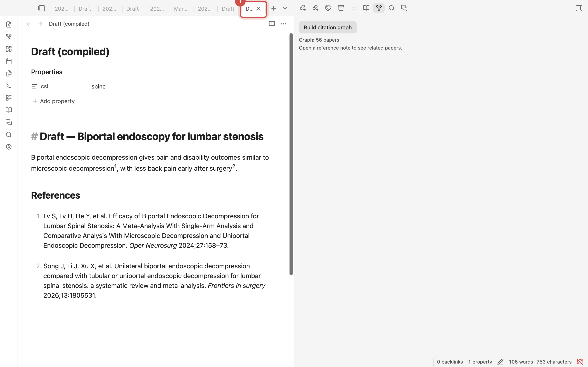

1. **Compile manuscript** laisse l'original intact et ouvre une nouvelle note
   **Draft (compiled)**. Les citations sont mises en forme et la liste de références est jointe,
   prête pour la soumission. Pour obtenir un fichier Word, lancez **Export manuscript to Word (.docx)**.

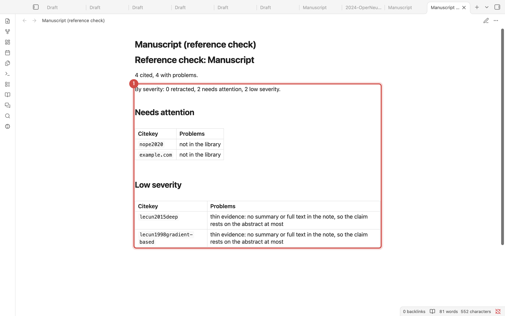

1. Le rapport s'ouvre dans une nouvelle note, **nom du manuscrit (reference check)**, à côté du manuscrit. Les problèmes sont regroupés par gravité : d'abord **Retracted**, puis **Needs attention** (absent de la bibliothèque, sans DOI ni PMID, preprint, métadonnées manquantes), enfin **Low severity** (jamais vérifié pour rétractation, ou ni résumé ni texte intégral dans la note). Corrigez les deux premiers groupes avant la soumission.

> **Préfixes et localisateurs de page.** **Compile manuscript** et l'export Word conservent le préfixe et le localisateur de page d'une citation : `[see @lv2024efficacy, p. 23]` est compilé avec « see » et le numéro de page intacts.

> **Anciens résumés.** **Re-summarize references made by an older model** demande, avant de commencer, de quel modèle refaire les résumés (avec le nombre par modèle). Les résumés faits à partir du texte intégral d'un PDF ne sont jamais modifiés.

## 11. Revues systématiques (facultatif)

Ces outils servent aux revues systématiques et aux méta-analyses. Activez-les dans
**Settings → Systematic review → Systematic review tools**. Une bibliothèque qui contient déjà des décisions de
screening les garde activés ; une nouvelle bibliothèque les démarre désactivés. Les désactiver ne fait que masquer
les commandes ; tout ce qui est déjà enregistré dans vos notes est conservé.

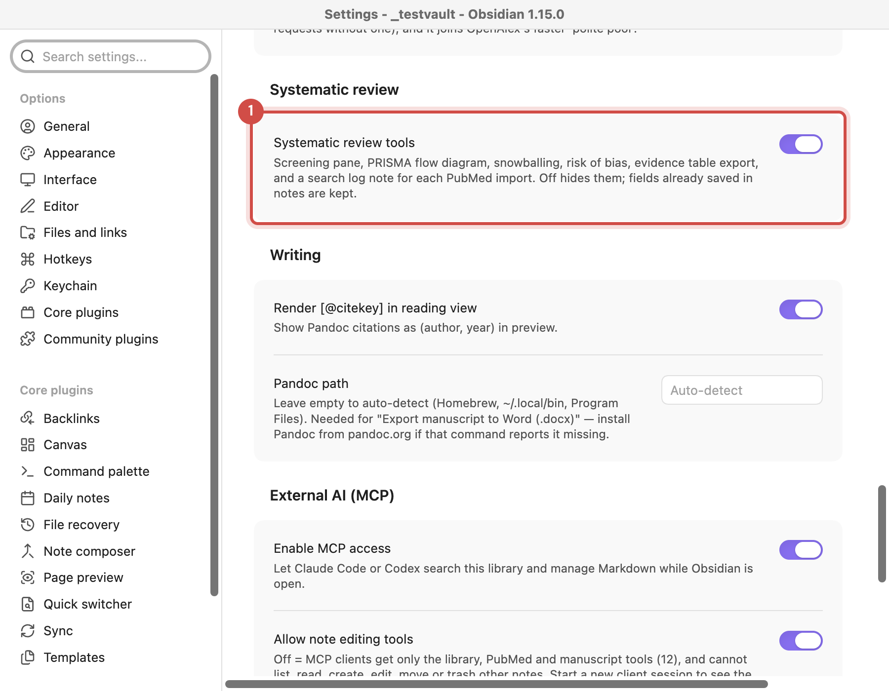

1. Activez **Systematic review tools**. Les commandes ci-dessous apparaissent alors dans la palette de commandes.

| Commande ou emplacement | Fonction |
|---|---|
| Open screening pane | Examine un enregistrement à la fois : include / exclude / maybe, questions clés, niveau de preuve, design, motif d'exclusion, et une ligne **Risk of bias** (outil, jugement global, note). Les raccourcis clavier fonctionnent partout |
| Search PubMed (import) | Chaque import écrit aussi une note sous `Searches/` avec la requête exacte, la date, les filtres, le nombre de résultats et les PMID renvoyés et importés, afin de pouvoir rapporter la recherche (PRISMA-S) |
| Create PRISMA flow diagram | Écrit les effectifs et le diagramme PRISMA 2020, et liste les recherches journalisées avec les enregistrements qu'elles ont identifiés |
| Snowball from included records | Pour chaque enregistrement inclus (ou une question clé), collecte les articles qu'il cite et les articles les plus récents qui le citent depuis OpenAlex, écarte ceux déjà dans votre bibliothèque, et écrit une liste classée d'au plus 200 candidats à examiner |
| Study (Screening pane) | Donnez le même study id à tous les rapports d'une même étude (protocole, rapport principal, suivi, correction). Le panneau liste les autres rapports de cette étude, et le diagramme PRISMA compte alors séparément les rapports et les études. Les notes ne sont pas fusionnées |
| Risk-of-bias summary table | Un tableau par outil d'évaluation (RoB 2, ROBINS-I, QUADAS-2, NOS, AMSTAR 2), les effectifs par jugement, et les enregistrements inclus pas encore évalués |
| Export evidence table (CSV) | Enregistre chaque résultat extrait (la section *Evidence (extracted)* de la note) d'un périmètre dans un seul CSV sous `Exports/`, avec des colonnes de référence et de screening, pour R ou RevMan. Les valeurs sont copiées telles qu'écrites ; le texte coréen s'ouvre correctement dans Excel |

Lancez **Open screening pane** pour faire le screening de la bibliothèque notice par notice.

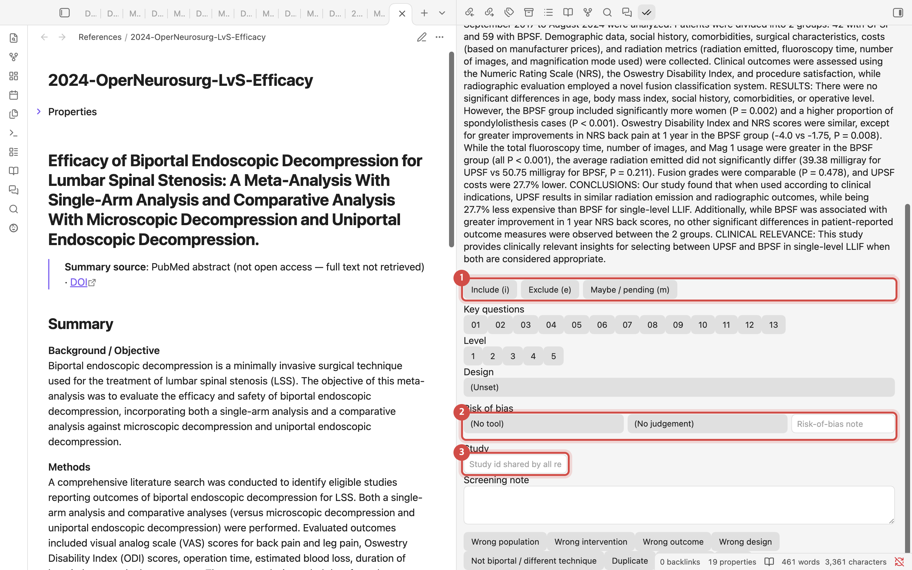

1. La décision : **Include (i)**, **Exclude (e)** ou **Maybe / pending (m)** ; les lettres sont des raccourcis clavier. Include exige au moins une question clé.
2. **Risk of bias** : l'outil d'évaluation, le jugement global et une courte note. **Risk-of-bias summary table** les rassemble.
3. **Study** : donnez le même identifiant à tous les rapports d'une même étude. Le volet liste alors les autres rapports de cette étude, et le diagramme PRISMA compte séparément rapports et études.

Lancez **Snowball from included records…**, choisissez toutes les notices incluses ou une question clé, et le résultat s'ouvre dans une note.

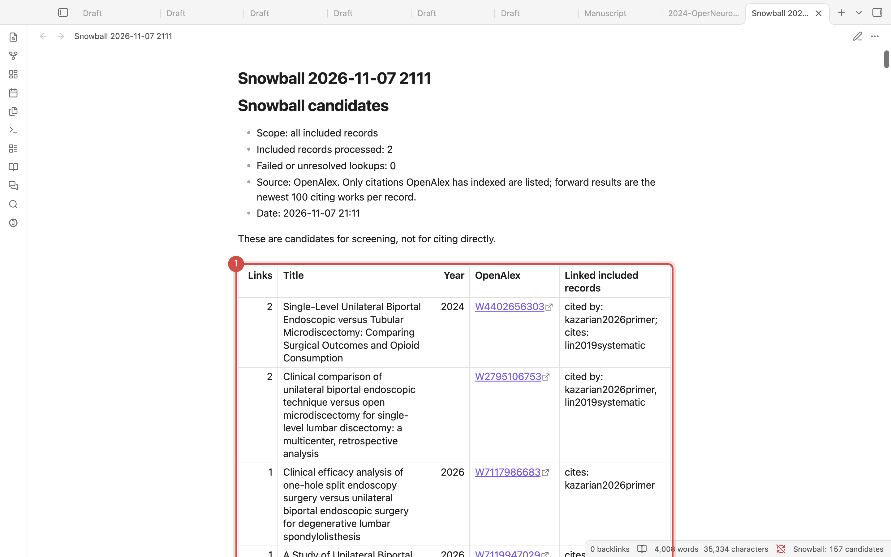

1. Le tableau classe les candidats selon **Links**, le nombre de notices incluses qui les citent ou qu'ils citent. **Linked included records** les nomme. Les articles déjà dans votre bibliothèque sont écartés ; la note contient jusqu'à 200 candidats.

Les candidats du snowballing sont à examiner, non à citer directement : ajoutez un article et lisez-le d'abord.

---

Captures d'écran : plugin v0.11.3 sur un vault de test de 56 articles. Les réponses du chat sont la sortie brute
du modèle, sans retouche. Les mainteneurs régénèrent les captures avec `python scripts/manual/capture.py en`.
